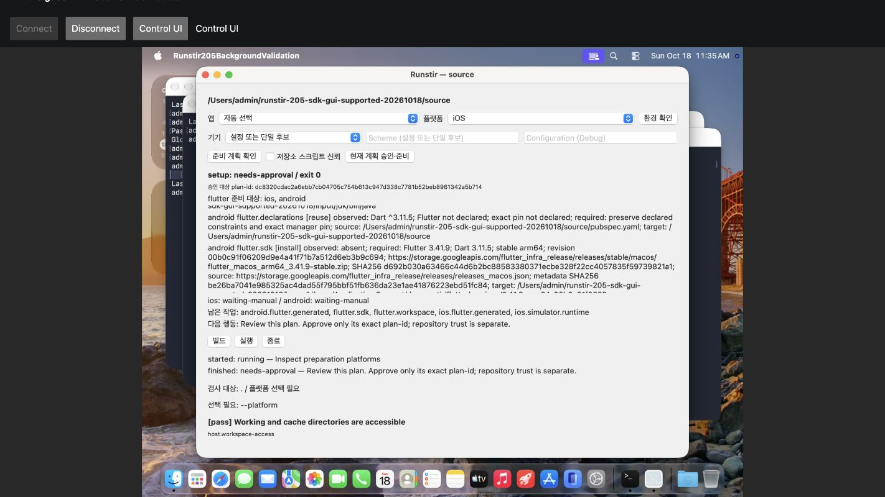
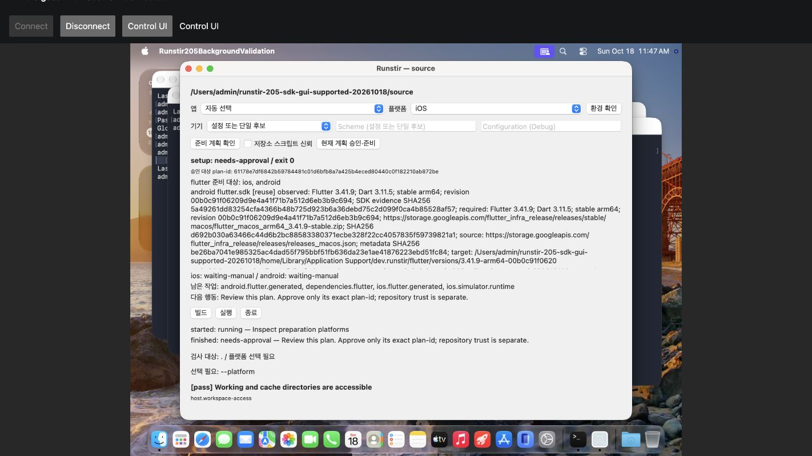
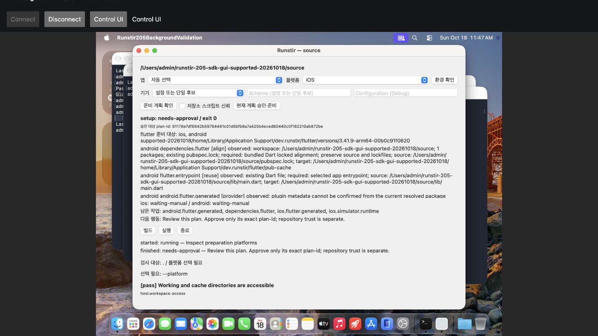

# #205 24ee SDK GUI 실측

GUI는 실제 SDK 다운로드를 취소한 뒤 새 검사·재승인으로 SDK 설치를 완료했다. 화면 결과는 취소 `130`, 재시도 `partial / 1`이다. 이 두 값은 **GUI operation의 표시 값**이다. GUI 프로세스6209의 native 종료는 정상 quit 뒤 `0`이다. 마지막 strict 보존 검사는 **FAIL**이다. 전체 환경 준비나 #205 완료를 뜻하지 않는다.

[구조화 결과와 전체 원본54개 pin](sdk-gui-24ee6e9.json): `55416B / 7b42675da6e4d7cbf9ad8e53278b3cd7a3a5bf316277529a5c053198691500e4`. 이 문서의 자기 SHA는 기록하지 않는다. README와 manifest는 별도로 동결한다.

## 입력과 승인

- source `24ee6e9752e1f39ac6a999113743e054082fed48`, tree `4bd46b907b9d43dfee68207358515a88e9028c82`다.
- private ad-hoc GUI binary SHA256은 `1a658c2edfa7c8fa975052ae6d310360a86424094eb7b8c141793759600c5acd`다. Developer ID·공증·공개 배포 증거가 아니다.
- 별도 GUI root는 시작 시 SDK가 없었다. 공식 Flutter3.41.9/stable arm64, Dart3.11.5, revision `00b0c91f06209d9e4a41f71b7a512d6eb3b9c694`를 승인했다.
- 공식 ZIP은 `2147160009B / d692b030a63466c44d6b2bc88583380371ecbe328f22cc4057835f59739821a1`이다. 자동 action은 `flutter.sdk` 하나다. resource key는2개다. repository trust는 false다.
- Root의 최초·재시도 승인 원본2개와 전체 제품 화면12개 pin은 JSON에 연결했다. SDK 뒤 Dart/native 단계는 승인하지 않았다.

## 실제 순서와 화면

1. plan `dc8320cdac2a6ebb7cb04705c754b613c947d338c7781b52beb8961342a5b714`의 SDK identity·checksum·trust 미선택을 검토했다. 최초 승인과 재시도 승인에서 같은 SDK-only 범위를 확인했다.

   

2. curl6479의 공식 payload가 `2600960→91615232B`로 증가했다. GUI 취소 뒤 화면은 cancelled/exit130이다. 같은 GUI process는 계속 실행됐다. SDK는 없고 소유 stage는 `[]`, 두 lease는 unheld다. after-cancel12397은 strict 보존 실패로 native1이다.

   

3. native read-only plan6583/exit0과 GUI 새 검사를 거쳤다. Root가 trust=false·SDK-only를 다시 승인했다. 새 curl6853은 새 D917… stage에서 같은 공식 artifact를 받았다. 화면은 partial/exit1과 completed `flutter.sdk` 하나를 표시했다. 다음 Dart/native action은 미승인이다.

   

4. GUI 읽기 전용 재검사는 exit0을 표시했다. 새 plan은 `61178e7df6842b59784481c01d6bfb8a7a425b4eced80440c0f182210ab872be`다. 별도 native CLI post-plan7170도 exit0이며 양쪽 SDK check는 reuse다. autoApproved/autoExecuted는 false다.

   

   

5. GUI6209는 `11:47:58Z`에 정상 native exit0으로 끝났다. after-quit observer는 해당 GUI와 관측한 현재·이전 child가 없음을 기록했다. final after47263은 strict 보존 실패로 native1이다. export51385와 local decode53078은 native0이다. transport·GUI process·GUI operation 결과를 서로 대신하지 않는다.

원본 `.png` 이름의 화면 파일은 실제 JPEG bytes다. 공개 파일은 `.jpg`로 쓴다. 선택한5개는 원본 bytes와 같다. 변환·resize·마스킹을 하지 않았다. 다른 이미지와 인증 화면은 복사하지 않았다. 원본12개는 경로 alias·bytes·SHA·실제 MIME로만 연결한다.

## SDK 완료와 보존 FAIL

설치 SDK는21,990 rows다. census SHA256은 `e8fef0699a9944f66487f8e49e2862c8512081f2692f90e96460afc01db6c1ce`다. 설치 metadata의 Flutter3.41.9/Dart3.11.5와 regular Dart executable bytes를 연결한다. 이는 Flutter bootstrap·앱 build/run·첫 화면의 증거가 아니다. 완료 ZIP을 별도 보관해 독립 재해시했다는 주장도 하지 않는다.

취소 뒤와 최종 after는 모두 `sourceFull=false`, `defaultInventory=false`다. 나머지8개 보존 항목은 true다. protected6 maps에는 완료한 SDK CLI의23,017 rows가 포함된다. maps는 그대로다. 마지막 소유 stage는 없고 두 lease는 unheld다.

source full census는140→142 rows다. 기존 `xcshareddata` 부모 directory size가128→160으로 바뀌었다. `swiftpm`과 `configuration` directory가 추가됐다. `swiftpm`에는 `configuration`만 있고 그 안은 비어 있다. 기존 tracked67의 bytes/mode는 같다. directory actor는 UNKNOWN이다. directory를 삭제하거나 복원하지 않았다.

기존 global device lastUsedAt 한 leaf는 `11:25:55Z→11:36:59Z→11:48:52Z`로 바뀌었다. actor는 UNKNOWN이다. 선택 cache에서는 validation VM의 Library/Caches mtime metadata만 달라졌다. 그 actor도 UNKNOWN이다. 선택 비교의 통과를 전체 HOME/cache 보존이나 strict PASS로 확대하지 않는다.

## 원본과 정상 종료 범위

원본54개 합계는110,623,677B다. 모든 decoded 원본의 bytes·mode·SHA를 export index와 대조했다. index는 `10894B / 009d194bfc14f092f2d4e2d005a8b978d8cf38c295e0ff77e62df25310f68525`다. raw stdout은 `147507122B / 7950171f21616a93a1ac0d8f725a12da72d959e1b34fd8e98e1129a969f408d1`다. JSON은 전체54개와 승인2개·화면12개·선택한 native capture 및 종료 metadata의 pin을 포함한다. raw base64·SDK/source/cache 내용·자격값은 넣지 않았다. auth/session 파일은 읽거나 해시하거나 복사하지 않았다.

NR3 legacy relay selfcheck FAIL은 별도 이력이다. static94 검토와 fresh view-only smoke 및 실제 background UI가 이를 소급 통과시키지 않는다. Root는 native Mac focus나 계정/access 설정 변경을 하지 않았다고 기록했다. proxy92385는 client-eof/native0이며 forced termination은 false다. Node91549와 relay91138도 Root가 정상 native0으로 수집했다. Root의 relay stop metadata는 workerStillRunning/uncertainOwnedProxyCleanup을 모두 false로 기록한다. 이 범위는 미관측 child나 전체 host 보존 증명이 아니다.

Root VM stop56938과 original boot12857도 native0이다. Root는 running VM `[]`를 확인했다. 기존 보호 VM5개의 before/after `VMs` dict는 같다. 범위는 작은 metadata의 full SHA와 VM disk stat이다. 전체 VM disk bytes/hash를 비교한 증거가 아니다.

## source·AC와 남은 gate

[FB Duo·Dart component](actual-supported-fb9167b.md)의 source는 FB다. 이를24ee exact actual로 재표시하지 않는다. 후속24ee의 설치 guard3줄/test57줄 영향 분석, [SDK CLI](sdk-cli-24ee6e9.md), [stale 승인 거부](selector-stale-24ee6e9.md)를 source별로 연결한다.

이 GUI actual은 #205 AC1의 공식 SDK 설치·재사용, AC3의 양플랫폼 부분 상태와 별도 승인, AC4의 실제 GUI 취소·재시도 및 앱 실행 구분에 연결한다. AC2의 workspace/entrypoint·native 수동 경계와 AC5/부모 AC02·AC03에는 plan·수동 단계·선택 보존·원본 FAIL을 함께 제시한다.

SDK GUI actual의 독립 Security 보고서는 추가 확정 결함0개를 기록했다. 보고서는 `19338B / 6b23e9a90f3dc565994953bf6fbec176c124c18cf2d5e6b64d08a6ccfcfdc758`로 고정했다. 같은 모델의 별도 컨텍스트다. 검토자는 앞선 SDK export decoder 작성자다. 제품·공통 helper 작성과 실제 operation 실행에는 참여하지 않았다. 원본54개·화면12개·승인2개·SDK·보호 root를 대조했다. strict FAIL과 actor UNKNOWN을 유지했다. 직접 raw가 있는 GUI·proxy·VM 결과와 Root의 도구 수집에 의존한 Node·relay 종료 및 running VM 요약은 구분했다. 이 결론은 최종 공개 문서 head의 승인이나 전체 보존 인증이 아니다.

최종 공개 manifest·whole-head 독립 리뷰·필수 CI·최종 head 사람 승인·병합·main CI·issue 종료는 별도 gate다. 결과는 PR #294에 기록한다. #222 공개 완료도 주장하지 않는다.
