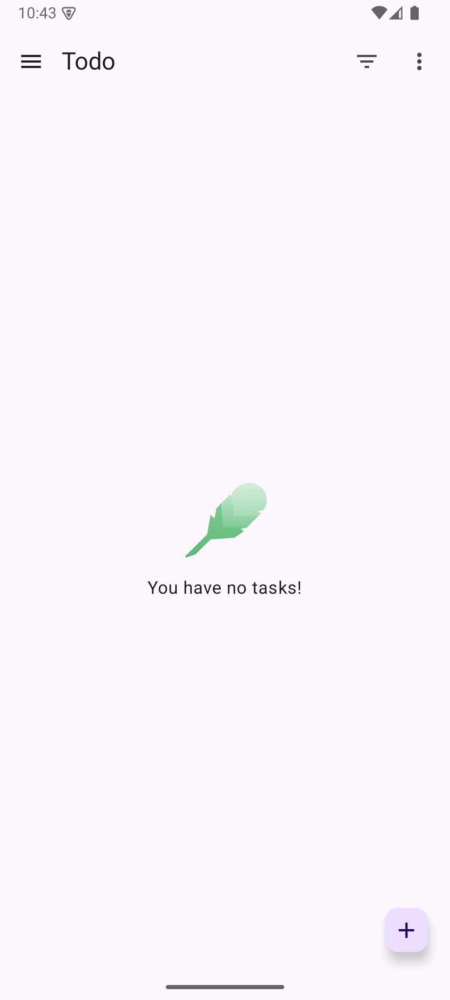
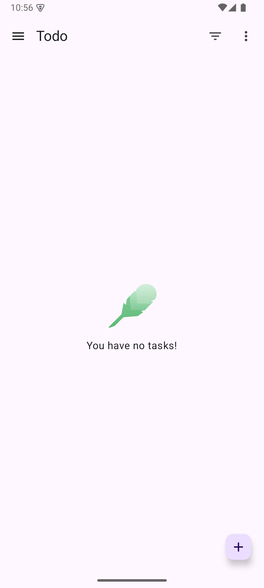

# #211 native Android CLI·GUI 실행 증거

이 문서는 `8862bcad5c003514cee73c41debe65b9301edf1e`의 로컬 검증 기록이다.
기준 base는 `b2c4cd6fd8077c71c31e31f0d721c6bf9d53cc16`이다.
Todo CLI·GUI의 실행과 가림없는 첫 화면을 확인했다.
NIA CLI·GUI의 최종 첫 화면을 확인했다.
재연결 뒤 GUI down과 선택한 자원의 endpoint 보존 감사를 확인했다.
분리 구간 전체의 연속 보존과 원래 GUI·ADB child의 정상 종료는 미확인이다.
이 문서는 #211 완료나 출시 준비 완료를 선언하지 않는다.

## 고정 입력과 범위

[고정 입력](input-tuple.json)은 #215 native baseline의 공식 archive 12개와 source SHA를 연결한다.
Runstir용 clone 네 개는 native baseline clone과 분리했다.
clone의 tracked bytes·mode·symlink와 index·stage·flags를 첫 Runstir 명령 전에 기록했다.
`fresh`는 인계 시점의 상태다.
실행 후 clone을 미사용 clone으로 표시하지 않는다.
#215의 native 성공은 #211의 Runstir 성공을 대체하지 않는다.

Todo는 `ee66e1526b84c026615df032c705842b7d2a521f`를 사용했다.
NIA는 `a49ed253d75e61a2b6ab80a8da677b57437b08eb`를 사용했다.
각 앱의 CLI·GUI는 별도 clone에서 같은 source·선택·archive 입력을 사용했다.
Todo는 `:app/debug`, SDK 35, Build Tools 34.0.0, JDK 17.0.19를 사용했다.
NIA는 `:app/demoDebug`, SDK 36, Build Tools 36.0.0, JDK 21.0.12.1을 사용했다.
기기 tuple은 소유한 API 35 `arm64-v8a` AVD와 전용 ADB server다.
이는 물리 기기 검증이 아니다.

CLI SHA256은 `60b5bfa34624e1812c7a858b85d1270426b82aa626a92d97656dcfa85edeb753`다.
GUI 실행 파일의 ad hoc 서명 후 SHA256은 `2468f4c57ac8d056012ed7c76e24e2fa7a701807070346124c2db424eb86c2f8`다.
이는 로컬 검증 candidate다.
Developer ID·공증·공식 배포 archive 검증을 뜻하지 않는다.

## 실제 결과

| 표본 | build | up·설치·실행 | 가림없는 첫 화면 | down |
| --- | --- | --- | --- | --- |
| Todo CLI V4 | up 내부 build 완료 | exit 0 | 확인 | exit 0 |
| Todo GUI V4 | up 내부 build 완료 | exit 0 | 확인 | exit 0 |
| NIA CLI V4 | 취소 130 뒤 재시도 0 | 최초 up 0; 알림 준비 뒤 1; cold boot 재시도 0 | 최초 캡처는 알림 창으로 가림; cold boot 뒤 확인 | 최초 down 0; 이미 종료된 소유 runtime cleanup 0; cold boot 실행 뒤 down 0 |
| NIA GUI V4 | `:app/demoDebug` build 0 | exit 0 | 확인 | 최초 guard 실패 1; 재연결 뒤 최종 0 |

[구조화된 결과](results.json)는 결과 시각과 원본 receipt SHA256을 연결한다.
[명령](commands.json)은 argv 경계를 보존한다.
명령의 개인 경로는 별칭으로 바꿨다.
원본 명령 JSON과 원본 argv의 SHA256은 각각 기록했다.
SDK·JDK·cache·temporary·전용 server 경로만 정규화한 환경 변수 whitelist를 공개한다.
사용자 식별값·인증 키 설정·나머지 환경 변수 원문과 원본 로그는 공개하지 않는다.

NIA CLI·GUI의 built APK와 설치된 APK SHA256은 모두 `fb84e3e51e1bcad1fbe4b365cc4c18fb5857aedac011b63fab8fbad66aece344`다.
Todo CLI·GUI의 built APK와 설치된 APK SHA256은 모두 `2eb53d7dfd51a60f904045cc0fc2c9b5e8d8b74754253a9be33baa32a6b5989a`다.
GUI 실행 중 CLI 충돌은 exit 1이었다.
CLI 실행 중 GUI 충돌도 exit 1이었다.
각 충돌 뒤 기존 앱 PID를 재관측했다.
Todo GUI down 뒤 앱·소유 Emulator 종료와 claim 부재를 확인했다.
5554·5555 listener 부재도 확인했다.
GUI는 Cmd-Q로 exit 0을 반환했다.

NIA 최초 up은 exit 0이었다.
알림 창이 앱을 가렸으므로 첫 화면 통과로 계산하지 않았다.
소유 AVD에서 Android `pm revoke`와 `set-permission-flags user-set user-fixed`를 실행했다.
두 명령은 exit 0이었다.
이는 실제 Android API를 사용한 수동 준비다.
UI에서 알림 거부를 누른 증거가 아니다.
준비 뒤 up 재시도는 launch 전에 실패했다.
완료된 validate·build·device·install과 남은 정리 안내를 그대로 보존했다.
후속 observer 7개의 실패와 유효한 캡처 부재도 남겼다.
소유 runtime 부재를 확인한 뒤 같은 stock `down`만 guard 밖에서 실행했다.
이 한정 예외와 `ownedRuntimeStopped=true`를 [시도 이력](attempts.md)에 기록했다.
소유 AVD cold boot 수동 준비 뒤 up 재시도는 exit 0이었다.
이 성공만으로 이전 timeout의 원인을 확정하지 않는다.
이어 수집한 NIA CLI 화면에는 관심사 선택 카드와 하단 탭이 가림없이 보였다.

## 첫 화면

아래 화면은 원본 PNG bytes를 그대로 복사했다.
Codex 에이전트가 네 화면을 직접 확인했다.
NIA에는 제목·관심사 카드·하단 탭이 보인다.
Todo toolbar·빈 목록 안내·잎 그림·추가 버튼이 보인다.
가리는 팝업과 crash·red box·빈 화면은 보이지 않는다.
원본 capture의 `firstScreenHumanReviewed=false`는 바꾸지 않았다.
후속 에이전트 관측은 별도 receipt에 있다.
이는 사람의 출시 승인이 아니다.

## 자동 검사와 수정 이력

`270fa34620ec67ca3132acc79aae7a7be446cb46`에서 전체 Werror 622 tests·75 suites가 통과했다.
`8862bcad5c003514cee73c41debe65b9301edf1e`의 `Sources`와 `Tests`는 그 commit과 byte가 같다.
이 동일성을 정적 `git diff`로 확인했다.
검증 로그 SHA256은 [비공개 원본 목록](private-evidence-index.json)에 있다.
이 evidence 작성 중 전체 테스트나 실제 도구 실행을 반복하지 않았다.

[시도 이력](attempts.md)은 V1·V2·V3 실패와 guard 오류를 보존한다.
소유 Emulator down 뒤 claim 누수와 이미 종료된 소유 Emulator의 claim 누수도 별도로 기록한다.
두 수정의 RED→GREEN 근거를 실제 첫 화면 증거와 구분한다.
이 문서 작성자는 #211의 일부 제품·테스트 작성자다.
이 문서는 독립 리뷰가 아니다.

## 수용 기준 연결

| 기준 | 연결한 증거 | 현재 한계 |
| --- | --- | --- |
| #211 evaluated module·variant·launcher·SDK/JDK | source tuple, GUI doctor, `:app`/`:app-nia-catalog` 및 `demoDebug`/`prodDebug` 후보, 공통 provider tests | 최종 고정 입력·후보 hash와 연결 |
| #211 정확한 debug 기본값·복수 flavor 명시 선택 | Todo debug, NIA demoDebug, V3 missing/wrong variant 차단 및 정본 설정 복구 | V3 실제 관측을 V4 실측으로 바꾸지 않음 |
| #211 doctor/build/up/down·안내·진행·active-run | 명령·진행·결과 receipt, Todo 양방향 충돌, down claim, typed teardown tests | 최초 실패와 재연결 뒤 down 0을 구분 |
| #211 CLI·GUI 산출물·실패·취소·정리·보존 | Todo 동일 APK와 화면, 취소 130, retry, 실패 이력 | NIA 동일 APK·두 화면·선택한 endpoint 보존 확인; 분리 gap 유지 |
| #199 AC01 | native Android 후보·선택 fixture와 실제 후보 | 여섯 framework-platform 조합 전체를 뜻하지 않음 |
| #199 AC04 | 공통 실행 tests, CLI·GUI 별도 실제 흐름, GUI build의 install/launch 부재 | 전체 수용 기준 완료를 선언하지 않음 |

## 외장 SSD 분리와 정리 경계

NIA GUI의 최초 down은 앱 종료 뒤 Emulator 관측에서 실패했다.
그 뒤 외장 SSD가 분리됐다.
재연결 뒤 공개 초안 12파일은 원래 SHA256과 같았다.
GUI·ADB manager는 offline 경로 생성 실패로 terminal exit 1이었다.
원래 GUI·ADB child의 exit status는 `unknown`이다.
process 부재를 정상 종료로 표시하지 않는다.
분리 구간 전체의 연속 보존도 주장하지 않는다.

새 검증 profile은 정확한 `/bin/ps`에만 `with no-sandbox`를 적용한다.
나머지 GUI 실행은 sandbox 안에 둔다.
새 profile의 bounded PID probe는 native 관측과 같았다.
허용 범위 밖 protected control 쓰기는 실패했다.
같은 candidate GUI의 down 재시도는 exit 0이었다.
Emulator는 이미 종료된 소유 runtime으로 표시했다.
재시작한 GUI와 ADB manager의 exit 0도 별도로 기록했다.
이 결과로 원래 GUI·ADB child의 unknown 종료 코드를 바꾸지 않는다.
상세 경계는 [시도 이력](attempts.md)과 [결과](results.json)에 있다.

## 보존과 남은 검증

[보존 범위](preservation.json)는 before·after endpoint snapshot을 연결한다.
공유 SDK 124165 entries와 기존 cache 27023·56229 entries 및 `.android` 13 entries는 `statOnly`다.
이 범위를 file content 동일성으로 확대하지 않는다.
global leases는 `hashRegularExceptSensitive`다.
기존 1151 entries는 바뀌거나 사라지지 않았다.
새 zero-byte regular `.lock` entry 780개는 따로 기록했다.
이 파일은 삭제하지 않았다.
각 새 lock의 actor는 별도 근거 없이 단정하지 않는다.
사전 부재였던 소유 검증 GUI preference 파일도 새로 생겼다.
기존 인증·global Gradle stat 행은 같았다.
전체 HOME와 전체 공유 SDK bytes의 보존을 주장하지 않는다.
공유 SDK·기존 cache·`.android`의 선택한 metadata 행은 before·after가 같다.
네 Runstir clone과 두 native 원본 clone의 tracked bytes·mode·symlink·HEAD·index·stage·flags·선택 hash도 같다.
이 결과는 endpoint 비교다.
SSD 분리 구간의 연속 보존을 증명하지 않는다.

최종 [cleanup·보존 receipt](cleanup-and-preservation-v4.json)를 연결했다.
재시작한 GUI PID 59627과 ADB PID 59556은 exit 0이었다.
최종 bounded PID 59627·59556·14767과 port 5045·5554·5555는 부재했다.
소유 active-run과 `01b688977656d9ab.claim`도 없었다.
protected control 41 bytes의 기대 SHA256과 after SHA256은 같았다.
evidence를 포함한 최종 head의 독립 리뷰와 필수 CI도 남아 있다.
broad 변경의 최종 head 사람 승인과 병합 및 main CI는 별도 게이트다.

[SHA256 목록](SHA256.json)은 이 공개 증거 파일의 bytes를 고정한다.
목록 파일 자체는 자기 hash에서 제외한다.
비공개 원본 경로는 별칭으로만 표시한다.
