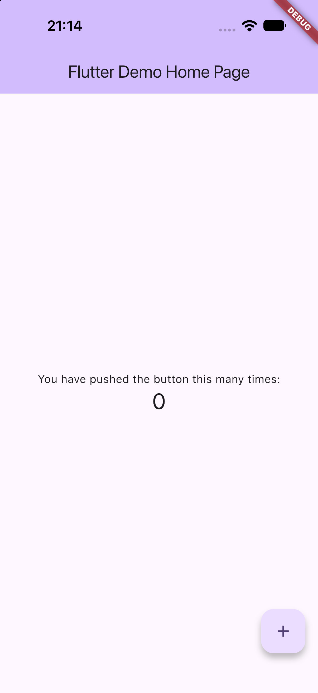
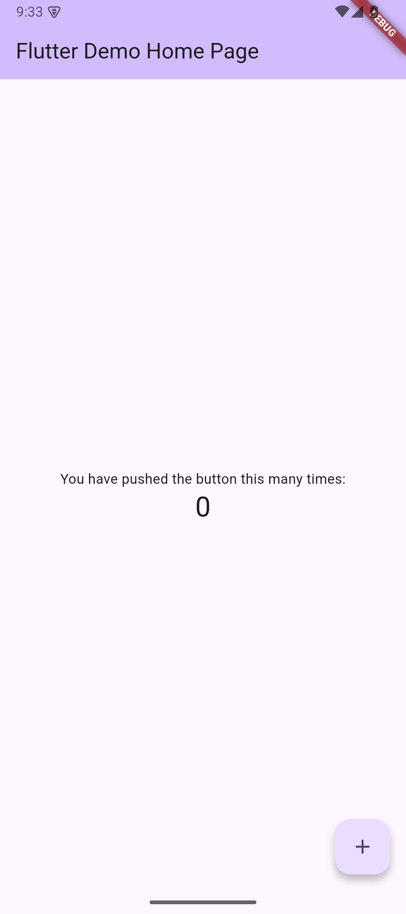
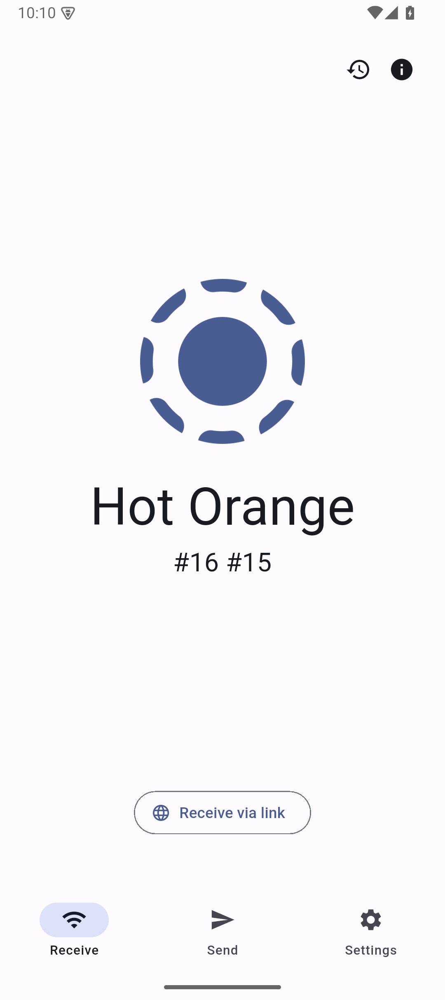
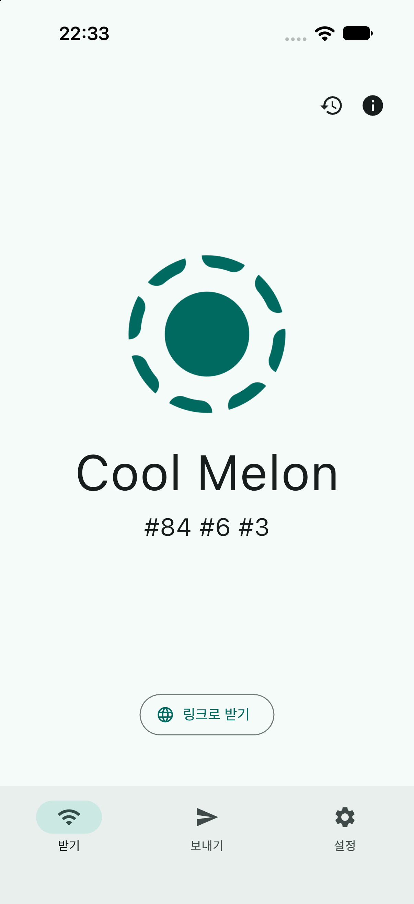

# #213 Flutter baseline 증거

상태: **승인한 입력의 양플랫폼 native baseline 4/4 PASS**.
필수 native 도구의 배포 identity 고정은 미완료다.
최소 앱 `66732bc…`와 prepared LocalSend `61145cf…`의 실제 첫 화면을 확인했다.
원본 LocalSend iOS의 frozen Pods 실패는 그대로 보존했다.
별도 fresh clone의 source·frozen Dart·frozen Pods 인계를 확인했다.
독립 리뷰·필수 CI·병합은 이 문서의 실행 결과에 포함하지 않는다.
후속 Runstir CLI·GUI 검증과 공동 1.0.0 출시는 아직 입증하지 않았다.

## 범위와 정본

- 작업 기준 Runstir source: `2e9f6422366e0bbe751332ae3b16c6ae87659019`.
- 명세: [#199](https://github.com/minjunkim-dev/mobile-runtime/issues/199)의
  Implementation Decisions 9절과 Testing Decisions AC05·AC06.
- 티켓: [#213](https://github.com/minjunkim-dev/mobile-runtime/issues/213).
- 이 작업은 `Runstir` 없이 baseline 입력을 준비한다.
- 제품의 Flutter provisioning이나 자동 migration 정책을 추가하지 않는다.
- 실제 baseline과 후속 Runstir fresh clone은 별도로 유지한다.
- 증거 root: `<evidence-root>`.
  작업 소유 제한 보관 위치의 별칭이다. 원본 접근은 작업 조정자에게 요청한다.
- 공개 로그는 명령·오류·단계 판정에 필요한 비식별 발췌다. 전체 원본 로그는 공개하지 않는다.
- 본문의 tuple·실행 receipt·입력 manifest SHA-256은 제한 원본의 identity다.
  공개 표현의 SHA-256은 `SHA256.json`에 있다. 두 표현의 연결은 `receipts/provenance.json`에 있다.
  공개용 별칭 치환과 발췌를 원본 byte 보존의 증거로 사용하지 않는다.

## 고정 후보와 최소 표본 교체

| 역할 | 원본 source | 앱 루트 | 의존성 workspace | entrypoint |
| --- | --- | --- | --- | --- |
| 원래 최소 후보 | [flutter/samples `5541c59ab8e9d7e74c1a35ef22bd43a487fc596c`](https://github.com/flutter/samples/tree/5541c59ab8e9d7e74c1a35ef22bd43a487fc596c) | `platform_design/` | 저장소 root | `lib/main.dart` |
| 실제 OSS 후보 | [localsend/localsend `c1ce322fb3acf08e44f329b8b7208b8b0d91e244`](https://github.com/localsend/localsend/tree/c1ce322fb3acf08e44f329b8b7208b8b0d91e244) | `app/` | 저장소 root | `lib/main.dart` |

원본 clone을 증거 root의 `sources/original-samples`와
`sources/baseline-localsend`에 보존했다.
두 clone의 HEAD는 위 source와 같다.
두 clone의 index와 tracked diff는 원본 HEAD와 같다.
`assume-unchanged`와 `skip-worktree` 항목은 없다.
이 단락은 실행 전 관측이다.
실행 후 원본·prepared 입력의 raw byte·mode·index 감사도 끝냈다.
최종 감사는 [final-preservation-audit.json](receipts/final-preservation-audit.json)에 있다.

초기 raw byte 목록은 증거 root의 `source-audits/`에 보존했다.
각 목록에는 tracked path·mode·HEAD blob·raw SHA-256이 있다.
Git index와 숨김 flag도 검사했다.
samples의 19개 Windows 파일은 원본 `.gitattributes`가 요구한 CRLF checkout이다.
선언한 EOL 변환 외의 차이는 없었다.
LocalSend에는 해당 EOL 변환이 없었다.
LocalSend의 Flutter submodule gitlink는 원본 SDK source를 가리킨다.
submodule checkout은 아직 수행하지 않았다.

| raw 목록 | tracked 항목 수 | 목록 파일 SHA-256 |
| --- | --- | --- |
| `samples-initial.json` | `2944` | `38ff03b49dee474091c9422003624b8a6c5ca1b7052d22d2039f513ceb33366b` |
| `localsend-initial.json` | `1030` | `861065f527bd317de770fb85e9156fdf4c6852dd924997d92e928ceadfa051a3` |

원래 최소 후보의 선언은 고정 Flutter `3.41.9`의 hard minimum과 충돌한다.

| 경계 | 원래 최소 후보의 선언 | Flutter `3.41.9` 경계 | 판단 |
| --- | --- | --- | --- |
| Gradle | [`gradle-wrapper.properties` 5행: `7.5`](https://github.com/flutter/samples/blob/5541c59ab8e9d7e74c1a35ef22bd43a487fc596c/platform_design/android/gradle/wrapper/gradle-wrapper.properties#L5) | `8.3.0` 이상 | 원본 선언으로 Android baseline에 진입할 수 없다. |
| AGP | [`settings.gradle` 26행: `7.3.0`](https://github.com/flutter/samples/blob/5541c59ab8e9d7e74c1a35ef22bd43a487fc596c/platform_design/android/settings.gradle#L26) | `8.1.1` 이상 | 같은 충돌이다. |
| Kotlin | [`build.gradle` 2행: `1.7.10`](https://github.com/flutter/samples/blob/5541c59ab8e9d7e74c1a35ef22bd43a487fc596c/platform_design/android/build.gradle#L2) | `1.8.10` 이상 | 같은 충돌이다. |
| iOS | [`project.pbxproj` 348·475·524행: `11.0`](https://github.com/flutter/samples/blob/5541c59ab8e9d7e74c1a35ef22bd43a487fc596c/platform_design/ios/Runner.xcodeproj/project.pbxproj#L348) | 해당 SDK의 migration이 이 선언을 바꾼다. | 원본 보존 조건에 위험이 있다. 실제 migration을 실행한 결과는 아니다. |

hard minimum의 정본은 Flutter source
[`00b0c91f06209d9e4a41f71b7a512d6eb3b9c694`의 `DependencyVersionChecker.kt`](https://github.com/flutter/flutter/blob/00b0c91f06209d9e4a41f71b7a512d6eb3b9c694/packages/flutter_tools/gradle/src/main/kotlin/DependencyVersionChecker.kt)다.
iOS 판단의 정본은 같은 source의
[`ios_deployment_target_migration.dart`](https://github.com/flutter/flutter/blob/00b0c91f06209d9e4a41f71b7a512d6eb3b9c694/packages/flutter_tools/lib/src/ios/migrations/ios_deployment_target_migration.dart)다.
이 판단은 실행 실패나 known-good 검증 결과를 뜻하지 않는다.

사용자는 #199의 부적격 표본 교체 규칙에 따라 공식 scaffold 교체를 승인했다.
고정 SDK를 검증한 뒤 다음 명령으로 새 최소 앱을 생성했다.

```text
flutter create --no-pub --platforms=ios,android --org dev.runstir --project-name runstir_flutter_minimal <evidence-root>/sources/baseline-minimal
```

앱 루트와 의존성 루트는 `sources/baseline-minimal`이다.
entrypoint는 `lib/main.dart`다.
생성 직후 lockfile 없는 source를 먼저 commit했다.
별도 `PUB_CACHE`로 `flutter pub get`을 실행했다.
이 명령은 `0`으로 종료했다.
기존 tracked 파일에는 변화가 없었다.
새 `pubspec.lock`만 추가하여 baseline source를 고정했다.

| 최소 앱 입력 | 고정 identity |
| --- | --- |
| generator SDK / template tree | `3.41.9` / `926163d810320a3d9c6f026aa638708bde1aa858` |
| 생성 직후 source commit | `7fa8323f89965bfdb69c0f647330d94eab47d1d6` (66 files) |
| lock 포함 baseline source commit | `395691c2a2e1854d73133d866323b7ad64e90264` (67 files) |
| baseline source tree | `22c5c23d1022415926a82e4c78faa1cb90becc53` |
| `pubspec.lock` SHA-256 | `353b981ec19ef69d4e918807244fb842547ebde79b7e00702824513756d4bb89` |
| `source-audits/minimal-source.bundle` SHA-256 | `c837c7e72326e20231cda201b695ae3da5727a4c485802b087aeb458691404b9` |

첫 생성 source의 iOS deployment target은 `13.0`이었다.
Xcode 27은 이 입력을 Target Integrity 오류로 거부했다.
이 source와 실패 로그를 보존했다.
별도 최소 검증 입력의 deployment target 세 곳만 `15.0`으로 명시했다.
사용자는 공식 scaffold의 이 입력 작성을 승인했다.
이는 LocalSend나 사용자 프로젝트의 자동 migration 허용을 뜻하지 않는다.
새 source는 `66732bc18ed28d9eed71336b4a2b018e09ad20b9`다.
새 tree는 `1b2c0f69a98890901706439215227d533bb69b7a`다.
`pubspec.lock`은 위 SHA-256을 유지한다.
이 source를 두 플랫폼의 최소 역할 입력으로 사용한다.
원래 최소 후보의 source와 위 부적격 기록은 보존한다.
LocalSend의 원본 source와 선언은 유지했다.
실제 OSS의 양플랫폼 입력에는 별도로 승인한 prepared source를 사용했다.

## 최소 앱의 실제 iOS baseline

| 입력 | 고정 값 |
| --- | --- |
| source | `66732bc18ed28d9eed71336b4a2b018e09ad20b9` |
| Flutter / Dart | `3.41.9` / `3.11.5` |
| Xcode / Simulator SDK | `27.0 (27A266a)` / `27.0 (24A430)` |
| runtime | 기존 `iOS 27.0 (24A434)` |
| 소유 Simulator | `Runstir-213-iPhone18Pro`, `<owned-simulator>` |
| device type | `com.apple.CoreSimulator.SimDeviceType.iPhone-18-Pro` |
| build 선택 | Debug, `ARCHS=arm64`, `ONLY_ACTIVE_ARCH=YES`, 정확한 소유 UDID |
| signing | `CODE_SIGNING_ALLOWED=NO`, Simulator 실행 |
| 제한 원본 tuple JSON SHA-256 | `f3496411f6b5b58c8fe2494f56d67b8d8a5282d86a7b77980cedcb1071d25193` |

직접 `xcodebuild`를 실행했다.
빌드 선택과 절대경로는 [최소 iOS tuple](receipts/minimal-ios15-arm64-tuple.json)에 있다.
실제 명령은 [최소 iOS build 로그 발췌](receipts/minimal-ios15-arm64-build.log.gz)의 `Command line invocation`에 있다.
경로와 소유 기기는 일관된 별칭으로 표시했다.
`-workspace ios/Runner.xcworkspace -scheme Runner -configuration Debug`를 사용했다.
`-sdk iphonesimulator -destination id=<owned-simulator>`를 명시했다.
DerivedData와 module cache는 증거 root 아래다.
빌드 결과는 `BUILD SUCCEEDED`, 종료 코드는 `0`이었다.
`Runner.app` 전체 파일 목록 SHA-256은
`17101bdee5fb25c9ab4c869e1961d0059465c1994eae7ac7f93b8f4d307a83f1`이다.

정확한 UDID에 `simctl install`과 `simctl launch`를 실행했다.
두 명령은 `0`으로 종료했다.
앱 ID는 `dev.runstir.runstirFlutterMinimal`이다.
실제 PID는 `99140`이었다.
PID의 실행 경로에서 소유 UDID와 `Runner.app/Runner`를 확인했다.
다음 화면을 직접 열어 확인했다.
`Flutter Demo Home Page`, 값 `0`, `+` 버튼이 보였다.
blank 화면과 Flutter 오류 화면은 없었다.



실행 receipt는 `logs/minimal-ios15-execution.json`이다.
receipt SHA-256은 `0b5cca183dc802dd91768c251f68294bd0c1a7975569fbe455226b8470164066`이다.
실행 뒤 tracked source·index·숨김 flag의 변화는 없었다.
소유 앱을 종료했다.
소유 Simulator를 Shutdown했다.
기존 Simulator들의 상태는 실행 전후 같았다.

앞선 실패도 보존한다.

| 시도 | 실제 결과 | 보존 로그 |
| --- | --- | --- |
| 첫 생성 source `395691c…`, iOS `13.0` | Target Integrity: 지원 범위 `15.0`~`27.0.x` | `logs/minimal-ios-build.log` |
| 새 source `66732bc…`, generic Flutter build | `lipo -verify_arch arm64 x86_64` 오류 | `logs/minimal-ios15-build.log` |
| 동일 새 source, 정확한 arm64와 소유 UDID | 빌드·설치·실행·첫 화면 PASS | `logs/minimal-ios15-arm64-build.log` |
| 외장 volume에 직접 screenshot 저장 | `EPERM`. 별도 소유 `/tmp` capture 후 같은 byte를 복사했다. | 실행 receipt |

고정 SDK나 `lipo`를 패치하지 않았다.
다중 architecture 검사 실패와 단일 arm64 검사 성공을 따로 재현했다.
선택한 arm64 기기에 맞춰 build 입력만 명시했다.
기존 Xcode 설치 archive의 checksum은 `unknown`이다.
설치된 Xcode build·SDK·실행기 identity와 전체 tuple을 보존했다.
이 결과는 최소 앱의 iOS 실행 한 건이다.
나머지 세 건은 아래 별도 tuple과 실행 receipt로 확인했다.

## 정식 Flutter artifact

LocalSend의 [`.fvmrc`](https://github.com/localsend/localsend/blob/c1ce322fb3acf08e44f329b8b7208b8b0d91e244/.fvmrc)는
Flutter `3.41.9`를 고정한다.
`app/pubspec.yaml`의 Flutter `^3.41.0`과 Dart `^3.11.0`은 범위다.
범위와 exact artifact를 구분한다.

| 항목 | 고정값 |
| --- | --- |
| channel / architecture | `stable` / `arm64` |
| Flutter / SDK source | `3.41.9` / `00b0c91f06209d9e4a41f71b7a512d6eb3b9c694` |
| bundled Dart | `3.11.5` |
| 공식 release 시각 | `2026-04-30T17:06:13.044098Z` |
| archive | `stable/macos/flutter_macos_arm64_3.41.9-stable.zip` |
| archive SHA-256 | `d692b030a63466c44d6b2bc88583380371ecbe328f22cc4057835f59739821a1` |
| metadata SHA-256 | `be26ba7041e985325ac4dad55f795bbf51fb636da23e1ae41876223ebd51fc84` |

정본은 [공식 release metadata](https://storage.googleapis.com/flutter_infra_release/releases/releases_macos.json)다.
[archive URL](https://storage.googleapis.com/flutter_infra_release/releases/stable/macos/flutter_macos_arm64_3.41.9-stable.zip)은 metadata의 `base_url`과 `archive`를 결합했다.
metadata 원본은 증거 root의 `downloads/releases_macos.json`에 보존했다.
다운로드한 archive의 크기는 `2147160009` bytes다.
raw SHA-256은 정본의 `d692b030…9821a1`과 일치했다.
압축 해제 뒤 `flutter --version --machine`은 `0`으로 종료했다.
실행 버전은 Flutter `3.41.9`와 Dart `3.11.5`였다.
SDK HEAD와 engine revision은 각각 `00b0c91…`와 `42d3d75a56efe1a2e9902f52dc8006099c45d937`이었다.
원본 결과는 `logs/flutter-version.json`에 보존했다.

과거 `/flutter_infra_release/flutter/releases/` metadata 요청은 `404`였다.
같은 과거 prefix의 archive와 `.sha256` 요청도 `404`였다.
이 실패를 해당 버전의 부재로 해석하지 않았다.
공식 사이트 source
[`d0f80ce71784dc65d01dbc9748bf3244e59660b8`의 release model](https://github.com/flutter/website/blob/d0f80ce71784dc65d01dbc9748bf3244e59660b8/sites/docs/lib/src/models/flutter_release_model.dart)은
현재 `/flutter_infra_release/releases/` 경로를 명시한다.
현재 경로의 요청은 `200`이었다.

## LocalSend의 수동 Rust 준비

[`rust-toolchain.toml`](https://github.com/localsend/localsend/blob/c1ce322fb3acf08e44f329b8b7208b8b0d91e244/rust-toolchain.toml)은
Rust `1.97.1`과 `clippy`를 요구한다.
LocalSend의 tracked `cargokit`은 부족한 Rust toolchain과 target을 설치할 수 있다.
실제 앱 빌드 전에 별도 `RUSTUP_HOME`과 `CARGO_HOME`을 준비한다.
이는 승인된 검증 입력의 수동 준비다.
Runstir의 범용 Rust provisioning 기능이 아니다.

정식 manifest는 [Rust `1.97.1` 배포 manifest](https://static.rust-lang.org/dist/channel-rust-1.97.1.toml)다.
원본과 checksum sidecar는 증거 root의 `downloads/`에 보존했다.
manifest SHA-256은 `03569b1886ceb5c05276b50c8431ab111de944cd6140fe1fa7d821dd8e0f29cf`다.

| 설치 항목 | 관측 |
| --- | --- |
| rustup 실행기 | 기존 `<user-home>/.cargo/bin/rustup`, `1.29.1` |
| 실행기 SHA-256 | `ec1b9233e7f72990ecd8e62063fa7f6c3dfc2bec8e97f88bff165f9100ac696a` |
| task 전용 rustc | `1.97.1 (8bab26f4f 2026-07-14)` |
| rustc source | `8bab26f4f68e0e26f0bb7960be334d5b520ea452` |
| 설치 target | `aarch64-apple-darwin`, `aarch64-apple-ios-sim`, `aarch64-linux-android` |

실행 명령은 다음과 같다.
`RUSTUP_HOME`과 `CARGO_HOME`은 증거 root의 `state/rustup`과 `state/cargo`다.

```text
RUSTUP_TOOLCHAIN=1.97.1 RUSTUP_AUTO_INSTALL=0 rustup toolchain install 1.97.1 --profile minimal --component clippy --target aarch64-apple-ios-sim,aarch64-linux-android --no-self-update
```

앞선 `rustup --version`은 비어 있는 task 전용 상태에서 `stable` 자동 준비를 시작했다.
`stable 1.99.0` 다운로드를 확인한 뒤 해당 작업의 PID `36255`만 종료했다.
종료 코드는 `143`이었다.
부분 다운로드는 task 전용 경로에 보존했다.
이 실행은 `1.97.1` 준비나 baseline 성공으로 세지 않는다.
뒤의 exact 설치 명령은 `0`으로 종료했다.

## 의존성 준비와 원본 보존

LocalSend는 app root에서 `flutter pub get --enforce-lockfile`을 실행했다.
첫 실행은 task PATH에 `git-lfs`가 없어 `69`로 종료했다.
공개 Git 의존성 clone의 `post-checkout`이 실패했다.
원본 source나 hook을 삭제하지 않았다.
기존 `git-lfs 3.8.0`을 task PATH에만 추가했다.
실행 파일 SHA-256은 `8e4ed79ff8562870a7f3b88993c221994e2bf44f8c65b930764b3f0ab0fcefa5`다.
동일 source와 lock의 두 번째 실행은 `0`으로 종료했다.
두 실행의 로그는 `logs/localsend-pub-get-attempt1-lfs.log`와
`logs/localsend-pub-get-attempt2.log`다.

두 번째 실행 뒤 LocalSend의 tracked raw byte 1,030개는 초기 목록과 같았다.
index는 원본 HEAD와 같았다.
숨김 flag는 없었다.
원본 `pubspec.lock` SHA-256은 `d14333a18b86726a4d8cc792bd3d65482d8e55e53f5895a3bd21d0cdcf7f5b3a`로 유지됐다.
원본 iOS `Podfile.lock`도 보존했다.
뒤의 frozen CocoaPods 준비 실패 뒤에도 같은 raw byte와 lock을 유지했다.

기존 Ruby `3.3.12 (2026-07-16 revision 0581089df9) [arm64-darwin23]`는 읽기만 했다.
원본 LocalSend의 `Podfile.lock`에 있는 CocoaPods `1.16.2`를 task 전용 경로에 준비했다.
`GEM_HOME`, `GEM_PATH`, `GEM_SPEC_CACHE`, `BUNDLE_USER_HOME`은 증거 root 아래다.
`GEMRC=/dev/null`로 사용자 gemrc를 제외했다.
RubyGems source를 `https://rubygems.org`로 명시했다.
`CP_HOME_DIR`와 `CP_CACHE_DIR`도 task 전용 경로다.
기존 `~/.cocoapods`와 사용자 CocoaPods cache를 설치 대상으로 사용하지 않는다.

설치된 gem은 CocoaPods를 포함해 36개다.
각 gem의 실제 version·platform과 cached `.gem` SHA-256을
[공식 RubyGems version API](https://guides.rubygems.org/rubygems-org-api/)의 `sha`와 비교했다.
36개 모두 일치했다.
원본 API 응답은 `downloads/gem-metadata/`에 보존했다.
전체 버전과 checksum은 `logs/gems-checksums.json`에 있다.
이 manifest SHA-256은 `c80d7d24f8a259a67e39c422b3018bdc7d67d1ad762d01a217b9da945bd7ea02`다.
격리한 `pod --version`은 `1.16.2`를 반환했다.

Gem 설치의 첫 명령은 지원하지 않는 `--norc` 옵션으로 `1`을 반환했다.
이 로그는 `logs/gem-install-unsupported-norc.log`에 보존했다.
`GEMRC=/dev/null`의 경계를 source로 확인한 뒤 해당 옵션을 제거했다.
두 번째 설치는 `0`으로 종료했다.
생성된 gem 실행기는 같은 bindir의 `ruby`를 요구했다.
task 전용 `tools/gem-bin/ruby` symlink로 기존 Ruby 실행기를 연결했다.
기존 Ruby와 설치된 gem의 source byte는 수정하지 않았다.

## 호스트와 실행 자원

| 항목 | 관측 |
| --- | --- |
| 환경 종류 | 실제 Mac. VM 결과가 아니다. |
| macOS | `27.0.1`, build `26A434` |
| hardware | `Mac16,8`, `arm64` |
| Xcode | `27.0`, build `27A266a` |
| 기존 Xcode 선택 | `/Applications/Xcode.app/Contents/Developer` |
| 기존 Android SDK root | `<shared-sdk-root>` |
| 기존 JDK 후보 | Zulu `17.0.19`, `Zulu17.66+19-CA`, `aarch64` |

기존 `xcodebuild`와 booted iOS Simulator를 관측했다.
이 작업은 기존 프로세스나 기기를 종료하지 않았다.
실제 실행 lease를 조정했다.
#214 종료 뒤 소유 Simulator 한 대에서 최소 iOS 앱을 실행했다.
앱과 Simulator를 종료한 뒤 iOS lease를 반환했다.
#215 종료 뒤 Android lease를 받았다.
Android 도구는 공유 SDK를 직접 사용하지 않는다.
같은 APFS volume의 task 전용 SDK COW 복제본을 사용한다.

도구 준비는 task 전용 `tools/`, `PUB_CACHE`, `GRADLE_USER_HOME`,
`RUSTUP_HOME`, `CARGO_HOME`, `XDG_CONFIG_HOME`, `XDG_CACHE_HOME`을 사용한다.
`HOME`, 전역 PATH, 전역 Xcode 선택과 기존 SDK·cache는 바꾸지 않는다.
Flutter source의 `Config._configPath`에서 XDG 경계를 확인했다.
기존 `~/.flutter_settings`와 `~/.flutter_tool_state`는 없었다.
`CI=true`와 `FLUTTER_SUPPRESS_ANALYTICS=true`는 Flutter의 `NoOpAnalytics`를 선택한다.
고정 Dart source도 `CI`에서 `NoOpAnalytics`를 선택한다.
전역 telemetry 설정을 바꾸는 `--disable-analytics` 명령은 실행하지 않는다.

## Android의 격리 경계와 최소 앱 실행

공유 SDK는 `cp -cR`의 읽기 원본으로만 사용했다.
복제 root는 `<evidence-root>/tools/android-sdk`다.
실제 SDK 도구·Gradle·ADB·Emulator는 이 복제본을 사용한다.
선택한 열 개 subtree의 모든 symlink와 resolved path를 검사했다.
선택 경로는 모두 복제 root 안에 있었다.
선택하지 않은 NDK `23.1`의 dangling buildbot symlink 네 개는 사용하지 않았다.
전체 SDK의 모든 symlink가 유효하다고 주장하지 않는다.
경계 기록은 `logs/android-sdk-boundary.json`이다.

macOS `sandbox-exec`로 모든 Android 실제 도구의 쓰기를 증거 root에 제한했다.
`HOME`과 공유 SDK에 대한 쓰기는 허용하지 않았다.
기존 key·known_hosts·console token에 대한 쓰기도 허용하지 않았다.
기본 ADB `localhost:5037` 연결을 차단했다.
자체 검증에서 경계 밖 쓰기와 `5037` 연결은 `EPERM`이었다.
증거 root의 쓰기는 성공했다.
소스나 도구의 인증을 해제하지 않았다.
`TMPDIR`, Java prefs, Gradle, Rust, XDG와 AVD 경로는 증거 root 아래다.
Gradle의 자동 JDK·Android SDK 다운로드를 껐다.
전용 ADB 서버는 `5042`다.

첫 AVD 생성은 실패했다.
`ANDROID_USER_HOME`과 deprecated `ANDROID_PREFS_ROOT`를 함께 설정한 입력이 원인이었다.
설치된 SDK의 `getPrefsLocation()` probe가 변수 충돌 예외를 반환했다.
공식 권장 `ANDROID_USER_HOME`만 유지했다.
새 이름 `Runstir213_API35_ARM64_Attempt2`의 AVD 생성은 성공했다.
첫 부분 생성 디렉터리를 지우거나 덮어쓰지 않았다.
같은 원인으로 실패한 최소 앱의 첫 Gradle 시도도 보존했다.

| Android 최소 앱 tuple | 고정 값 |
| --- | --- |
| source | `66732bc18ed28d9eed71336b4a2b018e09ad20b9` |
| Flutter / Dart | `3.41.9` / `3.11.5` |
| Gradle | `8.14`, 정식 archive SHA-256 `efe9a3d147d948d7528a9887fa35abcf24ca1a43ad06439996490f77569b02d1` |
| JDK | 기존 Zulu `17.0.19`, `Zulu17.66+19-CA`, `aarch64` |
| SDK / NDK | compile·target `36`, min `24`, NDK `28.2.13676358` |
| AGP / Kotlin | `8.11.1` / `2.2.20` |
| image | `system-images;android-35;google_apis;arm64-v8a`, revision `9` |
| AVD / profile | `Runstir213_API35_ARM64_Attempt2` / `pixel_9a` |
| serial / ports | `emulator-5562` / ADB server `5042`, console `5562`, device ADB `5563` |
| Emulator / platform-tools | `37.1.11 (15917651)` / `37.0.1` |
| build | Debug, `--target-platform android-arm64 --no-pub --target lib/main.dart` |
| APK SHA-256 | `486b0ae6ccf448848e14b04c93a4de1a60c5c6328bd831d9593de5594b8e3182` |

Gradle archive는 [공식 `8.14` checksum](https://services.gradle.org/distributions/gradle-8.14-all.zip.sha256)과 실제 raw archive를 비교했다.
일치한 원본 archive와 sidecar를 보존했다.
LocalSend용 `8.13`도 [공식 checksum](https://services.gradle.org/distributions/gradle-8.13-all.zip.sha256)과 일치했다.
`8.13` archive SHA-256은 `fba8464465835e74f7270bbf43d6d8a8d7709ab0a43ce1aa3323f73e9aa0c612`다.
기존 JDK·Android SDK installer archive의 raw checksum은 `unknown`이다.
설치된 version·source properties와 선택 경로를 기록했다.

`flutter build apk`의 두 번째 시도는 `0`으로 종료했다.
정확한 serial에 설치한 결과는 `Success`였다.
정확한 activity의 시작 결과는 `Status: ok`, `COLD`였다.
PID는 `3315`였다.
`topResumedActivity`는 `dev.runstir.runstir_flutter_minimal/.MainActivity`였다.
저장한 화면을 직접 열어 `Flutter Demo Home Page`, `0`, `+` 버튼을 확인했다.
이후 해당 앱만 force-stop했다.
tracked source 67개·index·숨김 flag의 변화는 없었다.



최종 Android 입력과 실제 APK ABI는 [minimal-android-final-tuple.json](receipts/minimal-android-final-tuple.json)에 있다.
첫 시도 입력 record도 별도로 보존했다.
실행 receipt는 `logs/minimal-android-execution.json`이다.
receipt SHA-256은 `c7eb52ac834ff5f6dd641877e3e458ef1b9a7ddfa0838b186ed31e5e802df970`이다.
전역 Android 설정·key·known_hosts·console token은 내용이나 hash를 수집하지 않았다.
이 파일들의 `lstat` metadata를 실행 전후 비교했다.
최소 앱 실행 뒤 변화는 없었다.

Emulator의 첫 시작 로그는 기존 ADB **public** key를 자동 출력했다.
로그를 확인한 도구 결과에도 해당 public key가 포함됐다.
private key와 console token은 출력되지 않았다.
보존 로그의 두 public-key 행은 `[REDACTED]`로 비식별 처리했다.
이후 Emulator 시작은 스트림 필터를 거쳐 저장했다.
공개 증거에는 비식별 로그만 사용한다.
이 예외를 key 파일의 명시적 조회나 인증 해제로 숨기지 않는다.

## LocalSend iOS 준비 실패와 결정 경계

정확한 원본 source에서 frozen Pods 준비는 실패했다.
기본 Flutter의 `pod install` 호출에는 `--deployment`가 없었다.
작업 전용 wrapper에서 해당 옵션을 강제했다.
실제 오류는 `open_file_ios`, `system_date_time_format`의 추가와 `open_filex`의 제거다.
원본 native lock과 고정 Dart plugin 입력이 맞지 않았다.
source와 두 lock은 보존했다.
이 결과를 native build나 첫 화면 결과로 확대하지 않는다.

허용할 파일·명령·새 SHA 고정 시점·재검증 범위는
[별도 결정안](localsend-ios-decision-input.md)에 있다.
사용자는 선택 A의 별도 검증 입력을 승인했다.
원본 target override·Podlock 재생성·원본 migration은 수행하지 않는다.

## 승인한 LocalSend 검증 입력

| 입력 | 고정 identity |
| --- | --- |
| 원본 source | `c1ce322fb3acf08e44f329b8b7208b8b0d91e244` |
| 별도 prepared source | `61145cf100522363e9658af97137097551c64832` |
| prepared tree | `2346d8051c3f556fa545e9c48aa5c1bc7fc2446b` |
| 새 native lock SHA-256 | `5595ddad3deb164f454565e62ef48b3fae1e4d0b951116781f0246abe810825f` |
| native 입력 manifest SHA-256 | `eb742953e73a94d1be7c316966106d804e31b4f13f42b46a1f1c094ea7eba2a5` |
| [prepared Git bundle](localsend-prepared.bundle) SHA-256 | `d17f7af56dd559be567514391779f1a8e1083574299236e7f08535d41cf5c11f` |

bundle의 prerequisite는 원본 `c1ce322…` commit이다.
변경 파일은 `app/ios/Podfile`, `app/ios/Podfile.lock`,
`app/ios/Runner.xcodeproj/project.pbxproj`의 세 개다.
raw byte 감사에서 이 세 파일 외의 변경은 없었다.
원본 Dart lock은 유지했다.
새 native lock에 맞춘 `pod install --deployment`는 성공했다.
원본·prepared·fresh clone의 결과를 구분한다.

원본 Android는 두 번째 시도에서 build·install·launch·첫 화면을 확인했다.
[원본 최종 tuple](receipts/localsend-original-android-final-tuple.json)은 이 성공 시도의 입력과 실제 ABI를 기록한다.
`localsend-android-tuple.json`은 첫 시도 전 입력 record다.
실제 PID는 `3179`였다.
Receive 화면과 Receive·Send·Settings 탭을 직접 확인했다.
첫 capture의 로딩 화면은 settled 첫 화면으로 세지 않았다.
원본 tracked 1,030개의 raw byte·mode·index·숨김 flag는 유지됐다.
APK SHA-256은 `cda5f2b9fde845ca269c8c745f693b6554ba2970854f9cd3c5352e7863853796`이다.

실제 native target은 요청과 달랐다.
Flutter 요청은 `android-arm64`였다.
Cargokit은 `aarch64-linux-android`, `i686-linux-android`, `x86_64-linux-android`를 빌드했다.
추가 target도 동일한 Rust `1.97.1`의 공식 manifest에 연결했다.
최종 APK ABI는 `arm64-v8a`, `armeabi-v7a`, `x86_64`였다.
요청 target만 보고 단일 ABI라고 판단하지 않는다.
원본 Cargokit의 첫 실패를 일으킨 불완전한 작업 전용 stable 설치는 보존 격리했다.
기존 사용자 Rust 설치는 수정하지 않았다.

prepared source의 Android도 build·install·launch·첫 화면을 확인했다.
전체 입력과 실제 ABI는 [prepared Android tuple](receipts/prepared-localsend-android-tuple.json)에 있다.
실제 PID는 `3117`이었다.
APK SHA-256은 `5b5c90e3322ab1b0d905299432035e1cb322b9b584f393620f94af97b58263c5`다.
실제 launch 로그의 `LaunchState`는 `WARM`이다.
원본 실행 receipt의 `COLD` 표기는 [실제 launch 로그](receipts/prepared-localsend-android-launch.log.gz)로 정정했다.
원본 receipt는 로컬 증거 root에 보존했다.
`provenance.json`은 원본 receipt와 정정한 공개본의 hash를 구분한다.
요청·내부 target·실제 ABI 구분은 원본 실행과 같았다.
설치는 소유 AVD의 기존 소유 앱을 `-r`로 교체했다.
소유 앱 데이터는 유지했다.
이를 깨끗한 기기의 첫 설치라고 부르지 않는다.
실제 Receive 화면을 직접 확인했다.
원본 실행 receipt SHA-256은 `ce07ace613a69560c4c89b7c116d504aa752a0a88832b5a81ec9b77ca92fa1a9`다.
정정한 공개 receipt의 SHA-256은 `SHA256.json`에 있다.
tracked source 1,030개의 raw byte·mode·index·숨김 flag는 유지됐다.



실행 뒤 소유 앱·Emulator·ADB `5042`를 정상 종료했다.
`5037`, `5042`, `5562`, `5563`에 listener는 없었다.
기존 Android key·known_hosts·console token을 포함한 metadata 비교의 변화는 없었다.
공유 SDK의 `.knownPackages`와 선택한 `source.properties`도 같았다.

고정 source 안의 Cargokit은 별도 native build-tool runner를 생성한다.
이 runner는 원본 script의 `dart pub get --no-precompile`을 사용한다.
tracked app lock과 tracked Cargokit lock의 불변성을 따로 확인했다.
실제로 생성한 runner lock도 별도로 보존했다.
prepared runner lock SHA-256은 `a084a3090725b120fc3f4547048001e905cdb87a89de6cedab35ae0314a66826`이다.
이 bootstrap을 제품의 frozen provisioning 구현으로 부르지 않는다.

prepared iOS의 첫 실제 build 시도는 컴파일 전에 `65`로 종료했다.
작업 소유 DerivedData의 `info.plist`와 `LogStoreManifest.plist` atomic write가 `EPERM`이었다.
source·Pods·target의 compile 실패와 구분한다.
허용 root·DerivedData·TMPDIR의 literal 경로와 canonical 경로는 같았다.
각 경로는 작업 소유 root 안에 있었고 symlink가 아니었다.
POSIX·plutil 직접 쓰기는 성공했다.
별도 Foundation API probe의 atomic write는 같은 경계에서 실패했다.
Foundation의 `NSTemporaryDirectory()`는 지정한 `TMPDIR`과 다른 기존 사용자 temp를 반환했다.
새 작업 소유 internal temp prefix만 추가한 실험도 atomic write에 실패했다.
이 시점에는 실제 atomic 보조 경로를 확인하지 못했다.
이 실패만으로 경로 누락을 단정하지 않았다.
이 실패 때문에 sandbox를 해제하거나 HOME·공유 SDK·다른 DerivedData를 허용하지 않았다.

추가로 승인한 작업 소유 APFS sparseimage를 생성했다.
가상 용량은 `16 GiB`다.
이미지는 `native/ios-owned-volume.sparseimage`에 보존했다.
`verifyVolume`은 새 volume과 container를 `OK`, 종료 코드 `0`으로 확인했다.
legacy attach는 권한 거부로 실패했다.
현행 `diskutil image attach`는 신규 image를 attach했지만 mount를 완료하지 못했다.
해당 소유 client에만 `SIGINT`를 보냈다.
중복 attach 없이 정확한 소유 volume을 전용 mountpoint에 정상 mount하는 시도도 완료되지 않았다.
115초 뒤 해당 소유 client에만 `SIGINT`를 보냈다.
기존 daemon을 종료하거나 force 동작을 사용하지 않았다.
신규 image의 volume이 미부착 상태임을 확인했다.
정상 `hdiutil detach /dev/disk12`는 `0`으로 종료했다.
신규 image의 남은 attach는 없었다.
새 volume 내부 Foundation probe는 실행하지 못했다.
이 미실행을 probe 실패나 iOS compile 실패로 바꾸어 기록하지 않는다.
같은 probe를 반복하지 않았다.
기존 Simulator inventory는 이 시도 전후 같았다.
소유 `E2F84FD8…`도 Shutdown을 유지했다.

## prepared LocalSend의 실제 iOS baseline

전체 `HOME`·Apple 임시파일 write deny는 작업 조정자가 추가한 제한이었다.
이 제한과 사용자가 요구한 기존 SDK·cache·PATH·Xcode·원본 보존을 구분했다.
작업 조정자는 현재 사용자의 Darwin `T` 디렉터리에만 ephemeral write 예외를 승인했다.
`HOME`·cache·공유 SDK의 write deny는 유지했다.
인증이나 sandbox를 해제하지 않았다.

같은 Foundation probe를 이 경계에서 한 번 실행했다.
atomic write는 `1`로 성공했다.
실제 replacement 경로는 `T/TemporaryItems/NSIRD_FoundationAtomicProbe_kA1zYf/`였다.
이 관측 뒤 같은 경계에서 최종 native build를 실행했다.
정확한 profile과 probe 로그는 [receipts/](receipts/)에 있다.

| iOS OSS tuple | 고정 값 |
| --- | --- |
| source / tree | `61145cf100522363e9658af97137097551c64832` / `2346d8051c3f556fa545e9c48aa5c1bc7fc2446b` |
| Flutter / Dart / Rust | `3.41.9` / `3.11.5` / `1.97.1` |
| Rust target | 실제 `aarch64-apple-ios-sim` |
| Ruby / CocoaPods | 기존 `3.3.12` 읽기 / 작업 소유 gem `1.16.2` |
| native lock | `5595ddad3deb164f454565e62ef48b3fae1e4d0b951116781f0246abe810825f` |
| Xcode / SDK / runtime | `27.0 (27A266a)` / `27.0 (24A430)` / 기존 `iOS 27.0 (24A434)` |
| architecture / 목적지 | `ARCHS=arm64`, `ONLY_ACTIVE_ARCH=YES`, `id=<owned-simulator>` |
| build | Debug, `CODE_SIGNING_ALLOWED=NO`, 정확한 소유 DerivedData·module cache·result bundle |
| app ID / version | `org.localsend.localsendApp` / `1.18.2 (64)` |
| 실제 binary / min OS | `arm64` / `15.0` |
| 제한 원본 tuple SHA-256 | `73877c3c08888de7faf2662aa445b2ff3d665552d3729be529ff47b5a9ca68a9` |

최종 `xcodebuild`는 `BUILD SUCCEEDED`, 종료 코드 `0`이었다.
전체 argv의 별칭 표현은 [최종 tuple](receipts/prepared-localsend-ios-final-tuple.json)에 있다.
실제 원본 argv와 로그는 제한 경로에 보존했다.
같은 소유 Simulator의 install과 launch는 각각 `0`으로 종료했다.
실제 PID는 `98480`이었다.
PID의 실행 경로에서 소유 UDID와 `Runner.app/Runner`를 확인했다.
저장한 화면을 직접 열었다.
LocalSend Receive 화면과 소유 앱이 만든 `Cool Melon` alias를 확인했다.
`링크로 받기`, `받기`, `보내기`, `설정`이 보였다.
blank·오류·crash·권한 대기 화면은 없었다.



실행 receipt SHA-256은 `336a770e04dc52213ab46b0d869ad863b3fb67544b95ee93cb6561874d0b5169`다.
전체 앱의 파일 manifest SHA-256은 `d32bc6ec5515c93b60d2d2c82954814f964ddb3b055f7adf2c7a4a7c9ec1604e`다.
앱 204개 파일의 raw byte·mode를 작업 소유 durable 경로에 같은 값으로 복사했다.
실제 앱은 증거 root의 `native/prepared-localsend-ios/Runner.app`에 있다.
파일 합계는 `301464329` bytes다.
앱 binary를 이 Git 변경에 포함하지 않았다.

prepared source의 tracked 1,030개·mode·index·숨김 flag는 실행 뒤에도 같았다.
원본 `c1ce322…`의 별도 감사도 같았다.
소유 앱을 terminate했다.
소유 `E2F84FD8…`를 Shutdown했다.
모든 Simulator 상태의 실행 전후 diff는 `{}`였다.
iOS lease를 반환했다.
[최종 소유 자원 상태](receipts/final-resource-status.json)에서 앱 PID 소멸·소유 Simulator Shutdown·소유 Android 포트 listener 부재를 다시 확인했다.
런타임을 설치하거나 기존 기기를 변경하지 않았다.

임시 경로의 전후 비교는 `lstat` metadata만 수집했다.
전체 host의 동시 활동 때문에 모든 임시 변화의 원인을 이 작업으로 귀속하지 않는다.
기존 임시 파일의 내용은 읽거나 삭제하지 않았다.
작업 소유 build·probe 자료는 감사용으로 보존했다.
공개본은 경계·집계만 포함한다.
기존 사용자 key·token의 내용과 hash는 수집하지 않았다.
최종 global Android metadata·Flutter/Dart 설정·Xcode 선택의 diff는 `{}`였다.
공유 SDK의 `.knownPackages`와 선택 `source.properties`의 diff도 `{}`였다.
이 제한된 snapshot을 공유 SDK의 모든 byte 검사로 부르지 않는다.

최종 tuple 초안에 최소 앱의 설명 label이 남아 있었다.
초안을 보존한 뒤 LocalSend scenario·실제 native toolchain·실제 argv로 정정했다.
source나 도구 실행은 바뀌지 않았다.
정정 전후 hash는 [정정 receipt](receipts/ios-tuple-record-correction.json)에 있다.

## 고정 source와 fresh clone 인계

최소 앱 source를 [Git bundle](minimal-source.bundle)로 함께 보존한다.
bundle SHA-256은 `814788e74f8567dea21cb8bd442affbc08002a92e5ac02323a5bb740d45710f2`다.
bundle은 생성 직후 source·첫 lock·명시한 iOS 15 입력의 commit을 포함한다.
빌드 산출물과 cache는 포함하지 않는다.
별도 `sources/fresh-minimal-ios15`에 bundle을 clone했다.
source `66732bc…`와 tree `1b2c0f6…`를 다시 확인했다.
새 `PUB_CACHE`에서 `flutter pub get --enforce-lockfile`은 `0`으로 종료했다.
fresh clone의 source·index·lock에는 변화가 없었다.
이 결과는 source와 frozen 의존성의 인계 증거다.
fresh clone의 native 실행이나 후속 Runstir CLI·GUI 성공을 뜻하지 않는다.

처음 fresh cache를 지정한 명령은 baseline clone에서 실행됐다.
해당 로그는 `logs/minimal-fresh-cache-pub-get-misdirected.log`에 따로 남겼다.
그 명령을 fresh clone 검증으로 세지 않는다.
실제 fresh clone 경로에서 명령을 다시 실행했다.
정확한 인계 receipt는 [fresh-minimal-handoff.json](receipts/fresh-minimal-handoff.json)이다.

LocalSend의 별도 fresh clone은 원본 `c1ce322…`에서 시작했다.
이 clone은 `--no-local`로 만들었다.
prepared bundle을 fetch하고 `61145cf…`를 detach했다.
새 `PUB_CACHE`의 `flutter pub get --enforce-lockfile`은 `0`으로 종료했다.
새 CocoaPods home·cache의 frozen native 준비도 `0`으로 종료했다.
실제 명령은 `flutter build ios --config-only --simulator --debug --no-pub --no-codesign --target lib/main.dart`다.
작업 전용 wrapper가 `pod install --deployment`를 강제했다.
새 clone의 source 1,030개·mode·index·lock은 같았다.
인계 receipt는 [fresh-prepared-localsend-handoff.json](receipts/fresh-prepared-localsend-handoff.json)이다.
receipt SHA-256은 `1b2d3f588978e4244aed71062121f4134f7b4995ed269f16b1c55b93371f7e96`다.
이 fresh clone에서 native 앱을 다시 실행하지 않았다.
실제 네 baseline 실행과 이 source·의존성 인계를 구분한다.

후속 작업자는 LocalSend 원본 commit이 있는 새 clone에서 bundle을 검증한다.
다음 순서로 승인 입력을 선택한다.
cache·기기·toolchain은 후속 작업의 소유 경로를 먼저 정한다.

```text
git clone --no-checkout https://github.com/localsend/localsend.git <new-clone>
git -C <new-clone> checkout --detach c1ce322fb3acf08e44f329b8b7208b8b0d91e244
git -C <new-clone> bundle verify <absolute-evidence-path>/localsend-prepared.bundle
git -C <new-clone> fetch <absolute-evidence-path>/localsend-prepared.bundle HEAD
git -C <new-clone> checkout --detach 61145cf100522363e9658af97137097551c64832
```

원본 전체 로그와 source 감사는 증거 root에 보존한다.
리뷰용 tuple·실행 receipt·실패 로그는 [receipts/](receipts/)에 있다.
전체 원본 로그는 제한 경로에 보존했다.
공개 로그는 필요한 명령·오류·결과 행만 선택하고 경로·기기 식별자를 별칭으로 바꿨다.
공개 발췌는 원본 전체 로그나 원본과 같은 byte가 아니다.
[receipts/README.md](receipts/README.md)에 원본 hash 연결과 발췌 해제 방법이 있다.
공개 Android 로그에는 key 비식별 처리를 적용했다.
기존 key·token의 내용이나 hash는 공개 증거에 포함하지 않는다.
최소·prepared LocalSend의 실제 화면 네 개를 이 폴더에 보존한다.
전체 공개 파일 목록은 [SHA256.json](SHA256.json)이다.

## 수용 기준 감사

| #213 수용 기준 | 현재 증거 | 상태 |
| --- | --- | --- |
| source·루트·workspace·entrypoint·artifact·native tuple 고정 | 최소 `66732bc…`, prepared OSS `61145cf…`, 원본·교체 근거, 정확 SDK/Rust/gem·Gradle hash, 네 tuple | 부분 완료. 기존 Xcode/JDK/SDK installer archive의 checksum은 `unknown`이다. 필수 배포 identity 고정은 완료하지 못했다. |
| 원본 선언·migration·plugin·Rust 요구 확인 | 원래 최소 후보 hard minimum 충돌, LocalSend fixed Dart/Pod 모순, 승인한 세 파일 diff, 실제 Cargokit target·APK ABI | 기록 완료. 범용 migration/provisioning으로 확장하지 않았다. |
| 최소·OSS의 iOS/Android build·install·launch·첫 화면과 source 보존 | 최소 두 플랫폼 PASS, prepared LocalSend 두 플랫폼 PASS, 원본 별도 보존 감사 | 승인한 입력의 native baseline 4/4 PASS. |
| 실패·inconclusive·교체·fresh clone·수동 입력·화면 증거 인계 | 실패 이력, 사용자 승인 prepared source, source bundle, 별도 fresh clone frozen Dart/Pods, 네 화면, 최종 자원 감사 | 인계 증거 완료. fresh clone의 native 재실행은 미실행이다. |
| AC05·AC06 연결 | 고정 입력과 아래 후속 경계 | 연결 완료. 제품 전체 AC05·AC06는 미검증이다. |

#199 Implementation Decisions 9절은 baseline 전에 필요한 도구의 배포 checksum 고정을 요구한다.
설치된 도구의 version·build·선택 경로는 이 관측의 실행 identity다.
이 identity는 누락된 installer archive checksum을 대신하지 않는다.
따라서 실제 네 실행의 PASS와 #213의 전체 수용 기준 완료를 구분한다.
기존 Xcode·JDK·Android SDK의 동일 배포 identity를 연결하는 추가 근거가 필요하다.
해당 근거를 확보하지 못하면 예외 허용 여부를 별도로 결정해야 한다.
이 문서는 그 예외를 승인하거나 #213 전체 완료를 선언하지 않는다.

AC05의 네 native baseline 실행을 실제 Mac에서 확인했다.
모든 실행의 source와 자원 비교를 따로 보존했다.
이 문서나 artifact metadata를 실행 증거 대신 사용하지 않았다.
후속 Runstir CLI·GUI 검증은 별도 fresh clone에서 수행해야 한다.
AC06의 현재 관측은 실제 Mac의 환경 identity다.
Android 가속은 `Hypervisor.Framework OS X Version 27.0`으로 실측했다.
보존 기준 VM의 준비 경로 결과는 이 기록에 없다.
기준 VM의 source나 설정은 이 작업에서 변경하지 않았다.

이 변경은 native baseline 입력과 증거를 인계한다.
독립 리뷰·필수 CI·위험별 병합·main CI는 부모 작업이 별도로 조정한다.
