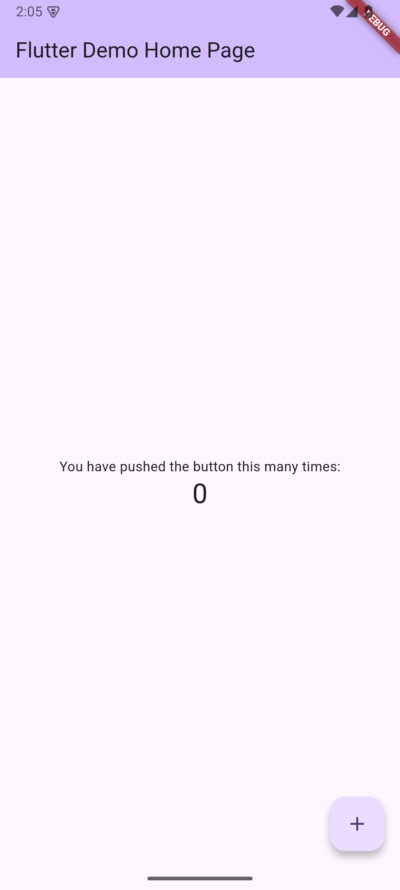
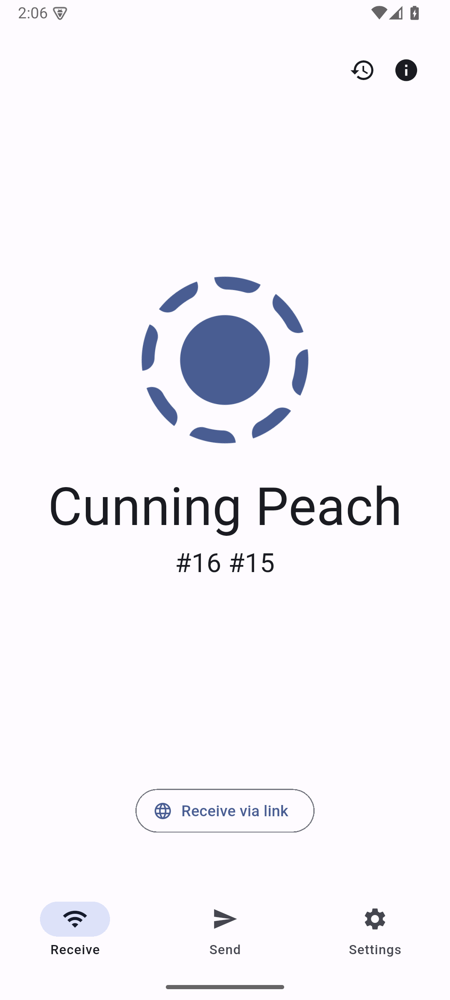
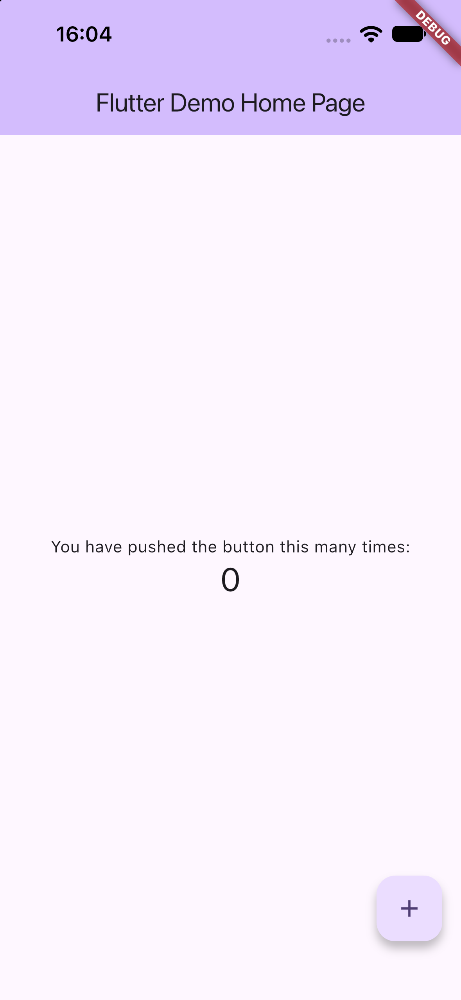
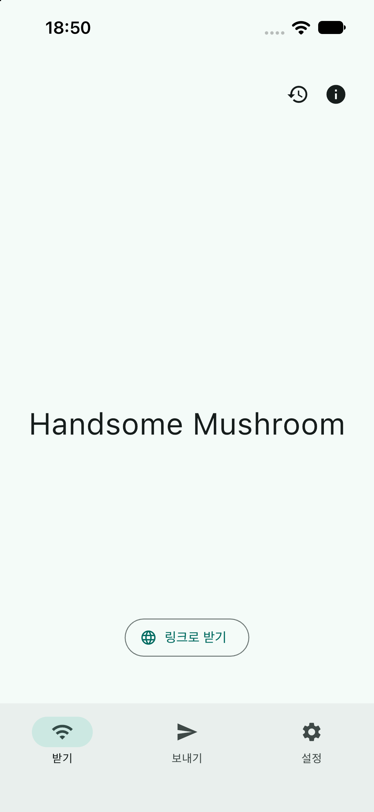

# #213 공식 입력 재고정과 새 native baseline

상태: **새 고정 입력에서 native baseline 4/4 PASS**.
Runstir 없이 최소 앱과 prepared LocalSend를 양플랫폼에서 실행했다.
작업 조정자 Root가 네 PNG를 직접 확인했다.
Runstir CLI·GUI 실행과 공동 1.0.0 완료는 이 결과의 범위가 아니다.
독립 리뷰·필수 CI·병합·main CI는 이 문서 이후 별도 확인한다.

이 묶음은 [기존 기록](../README.md)의 도구 배포 입력 부족을 해결하기 위한 새 실행이다.
기존 Xcode 27.0 실행과 `inconclusive` 판정을 보존한다.
기존 실행의 성공을 새 tuple로 승계하지 않았다.

## 고정 입력과 실행

정본은 [#199 §9](https://github.com/minjunkim-dev/mobile-runtime/issues/199)와
[#213 수용 기준](https://github.com/minjunkim-dev/mobile-runtime/issues/213)이다.
2026-10-16에 본문과 댓글을 다시 읽었다.
본문의 source·배포 checksum·수동 준비·실제 첫 화면 조건을 사용했다.

| 역할 | source / tree | 앱·의존성 루트 | 선택 |
| --- | --- | --- | --- |
| 최소 앱 | `66732bc18ed28d9eed71336b4a2b018e09ad20b9` / `1b2c0f69a98890901706439215227d533bb69b7a` | `.` / `.` | `lib/main.dart`, `Runner` Debug, `:app` debug |
| prepared LocalSend | `61145cf100522363e9658af97137097551c64832` / `2346d8051c3f556fa545e9c48aa5c1bc7fc2446b` | `app/` / repo root | 앱 기준 `lib/main.dart`, `Runner` Debug, `:app` debug |

호스트는 실제 Mac의 Apple Silicon `arm64`, macOS `27.0.1 (26A434)`다.
기준 VM을 부팅하거나 수정한 검증이 아니다.
Flutter는 공식 `3.41.9` arm64 ZIP이다.
ZIP 크기는 `2147160009` bytes다.
SHA-256은 `d692b030a63466c44d6b2bc88583380371ecbe328f22cc4057835f59739821a1`이다.
bundled Dart는 `3.11.5`다.
ZIP member의 bytes·link를 대조했다.
공식 member mtime 복원은 ZIP bytes 패치와 구분해 준비 이력에 보존했다.

[고정 tuple](native-tuples.json)은 공식 URL·전체 SHA-256·publisher checksum을 포함한다.
[명령 영수증](receipts.json)은 실제 argv·종료 결과와 원본 hash를 연결한다.
각 prepin의 준비 시점과 뒤의 실제 실행 결과를 구분한다.
LocalSend의 추가 의존성 준비를 앞선 최소 앱의 prepin으로 소급하지 않는다.

| 실제 native 실행 | 앱 ID | 설치 입력과 실행 근거 | 결과 |
| --- | --- | --- | --- |
| 최소 Android V7 | `dev.runstir.runstir_flutter_minimal` | APK `1fd259f4…`, 설치 digest 일치, PID `1997`, resumed activity | PASS |
| LocalSend Android V7 | `org.localsend.localsend_app.debug` | APK `80afd75d…`, 설치 digest 일치, PID `3608`, resumed activity | PASS |
| 최소 iOS V5 | `dev.runstir.runstirFlutterMinimal` | arm64, built↔installed 54개 regular 파일 bytes 일치, PID `76501` | PASS |
| LocalSend iOS V7 | `org.localsend.localsendApp` | arm64, built↔installed 204개 regular 파일 bytes 일치, PID `23795` | PASS |

각 native build는 `0`으로 종료했다.
설치·실행·정확 PID·앱 경로와 화면을 각각 확인했다.
[결과 목록](native-results.json)은 단계별 원본 영수증을 연결한다.
첫 화면 이후 전송·로그인·카운터 조작은 검증하지 않았다.

| 최소 Android | LocalSend Android |
| --- | --- |
|  |  |

| 최소 iOS | LocalSend iOS |
| --- | --- |
|  |  |

## Apple 배포 표현과 SDK/runtime

새 Apple 입력은 **현재 설치된 공식 Mac App Store Xcode.app 표현**이다.
원본 XIP를 확보하거나 그 checksum을 복원했다는 주장이 아니다.
Xcode `27.1`의 `version.plist` build는 `27A9275`다.
`Info.plist`의 `DTXcodeBuild`는 `27A9274`다.
두 raw 값을 서로 바꾸지 않았다.
CDHash는 `4ad8d2340894b2a0cb66b2baa4812b90dd858071`이다.
Apple 공개 서명 chain, strict verify와 `spctl`의 종료 코드 `0`을 기록했다.

Xcode 전체 표현은 regular `125859`개와 symlink `11146`개를 고정했다.
regular hash 대상 합계는 `10248479408` bytes다.
MAS receipt 한 항목은 stat만 수집했다.
semantic tree SHA-256은 `fb03a57623b64d43c10b4e10f20fc3c0b06908a0913b23db9569e02dfd779924`다.
이는 한 번의 전체 hash와 뒤의 metadata/name 대조다.
두 번의 독립 전체 hash나 vendor가 게시한 bundle checksum이라고 부르지 않는다.

컴파일 SDK는 **`iphonesimulator27.1 (24A94232)`**이다.
실행 runtime은 **`iOS 27.0 (24A434)`**이다.
`generic/platform=iOS Simulator`, `ARCHS=arm64`, `ONLY_ACTIVE_ARCH=YES`로 빌드했다.
설치·실행은 정확한 hostlocal custom device-set의 소유 UDID 하나만 사용했다.
기본 기기로 fallback하지 않았다.

runtime은 기존 Apple-signed RestoreDMG의 전체 bytes와 checksum을 고정했다.
크기는 `8067000161` bytes다.
SHA-256은 `5136453f500b73dc3518f262d8a51e4be0c136e38a550998febf7759de6ba0fd`다.
기존 readonly backing volume과 같은 filesystem object의 연결을 보존했다.
새 runtime 설치·계정 로그인·전역 Xcode 선택 변경은 없었다.
[Apple 공식 요구사항](https://developer.apple.com/xcode/system-requirements)의
Xcode 27.1 macOS 하한 `26.6`도 별도로 확인했다.

원본 XIP/PKG checksum과 vendor whole-bundle checksum은 `unknown`이다.
MAS receipt 내용은 읽거나 hash하지 않았다.
runtime 전체 plaintext tree hash는 수행하지 않았다.
기존 `modelmanagerd` unreadable 영역과 두 `PkgInfo`의 origin unknown도 유지한다.
새 배포 표현의 고정·서명·runtime binding을 이 미확인의 해결로 바꾸어 쓰지 않는다.
과거 #214의 실제 빌드 도구 bytes를 현재 27.1로 추정하지 않는다.

## Android 배포 입력과 실제 선택

공식 checksum을 검증한 archive를 새 소유 SDK/JDK 경로에 추출했다.
실제 native 명령은 새 소유 SDK·JDK·cache 경로를 선택했다.
기존 SDK root·cache·전역 PATH는 수정하지 않았다.
`android.builder.sdkDownload=false`를 실제 Gradle 수신값으로 확인했다.

| 입력 | 최소 앱 | LocalSend |
| --- | --- | --- |
| JDK | Zulu `17.0.19+10-LTS`, 배포 `17.66.19` | 동일 |
| Gradle / AGP | `8.14` / `8.11.1` | `8.13` / 실제 app AGP `8.12.1` |
| app Kotlin | `2.2.20` | `2.2.0` |
| compile SDK / Build Tools | `36` / 고정 `35.0.0` 입력 | `36` / 실제 `36.0.0` |
| app NDK | `28.2.13676358` | `28.2.13676358` |
| Flutter 요청 target | `android-arm64` | `android-arm64` |
| 완성 APK ABI | `arm64-v8a` | `arm64-v8a`, `armeabi-v7a`, `x86_64` |

LocalSend Cargokit의 내부 Rust target은 `aarch64`·`i686`·`x86_64` Android다.
Flutter 요청 target·내부 target·완성 APK ABI를 구분했다.
rust_lib extension metadata의 AGP 기본 NDK `27.0.12077973`도 보존했다.
NDK 27을 설치하거나 실행했다고 주장하지 않는다.
CMake `3.22.1` cache는 소유 NDK 28.2를 가리킨다.
그 cache 시각은 V6보다 앞선다.
V6에서 CMake를 새로 컴파일했다고 주장하지 않는다.

Emulator는 `37.1.11 (15917651)`이다.
입력 image는 API 35 Google APIs arm64-v8a r9다.
runtime의 `ro.build.version.sdk`는 따로 조회하지 않았다.
AVD는 한 개다.
ADB `5042`, console `5562`, Emulator ADB `5563`만 사용했다.

Zulu API size `192646000`과 실제 archive/CDN size `192646028`의 차이는 미해결이다.
정확한 전체 archive SHA-256은 공식 metadata와 일치한다.
이를 반올림이라고 설명하거나 size 차이를 숨기지 않는다.

## 표본의 허용 수정과 수동 준비

원래 `platform_design 5541c59…`의 부적격 근거와 교체 이력을 유지했다.
공식 scaffold의 첫 source와 iOS 13 Target Integrity 실패도 보존했다.
명시한 iOS 15 최소 입력 `66732bc…`를 새 baseline source로 사용했다.

LocalSend 원본 `c1ce322…`와 원본 Pod lock은 보존했다.
사용자는 별도 검증 clone에서 다음 세 파일만 수정하도록 승인했다.

1. `app/ios/Podfile`의 target 15 입력과 한정된 Simulator Debug Pods target.
2. `app/ios/Runner.xcodeproj/project.pbxproj`의 target 15 입력.
3. 고정 Dart plugin 집합에 맞춘 `app/ios/Podfile.lock`.

[승인·diff 기록](../localsend-ios-decision-input.md)을 유지한다.
새 prepared source는 `61145cf…`다.
Dart lock·Rust source·Android tracked bytes는 바꾸지 않았다.
새 실행에서도 tracked bytes·index와 Dart/Cargo/Pod lock은 같았다.
Flutter의 정확 PBX noop write와 CocoaPods `dirty=false` touch만 별도로 허용했다.
PBX bytes·index는 같았고 mtime/ctime 변화는 보존했다.
다른 migration이나 자동 복원을 허용한 기록이 아니다.

새 iOS 입력은 소유 Ruby `3.2.2`, CocoaPods `1.16.2`와 exact gem 38개다.
기존 global Ruby `3.3.12`는 보존했다.
공식 jdx Ruby archive SHA-256은 `13521c64d1d5579d97707b54321b82e7c7a7c779a919868ac9b4eb8e36da9ba9`다.
기존 36개 gem에 기존 default gem의 exact `benchmark 0.3.0`과 `securerandom 0.3.1`만 추가했다.
공식 archive·Ruby 요구·닫힌 gem 의존성·실제 설치 member를 대조했다.

네 원격 Pod는 frozen lock의 정확 version·공식 tag commit·source bytes로 준비했다.
실제 `pod install --deployment`는 네트워크 차단 상태에서 `0`으로 종료했다.
Pod cache 위치 오류와 PBX touch 거부의 이전 실패도 보존했다.
Rust는 exact `1.97.1`이다.
iOS Simulator std를 포함한 공식 component 8개, member 374개를 대조했다.
Cargo lock registry 509개 전체와 실제 선택 iOS closure를 구분했다.
기존 archive가 있던 329개를 직접 대조했다.
선택 iOS registry 312개가 검증한 집합에 있음을 offline resolution으로 확인했다.
`.cargo-checksum.json` 부재를 유지했다.
해당 파일을 합성하지 않았다.

Cargokit runner는 고정 25개 lock, 실제 hosted archive 24개와 local package 한 개를 사용했다.
package_config 26개 root를 실제 경로와 대조했다.
공식 Dart enforce 명령 한 번과 공식 Cargokit `--help` 한 번에 advisory metadata network 예외를 허용했다.
전후 dependency payload·version 디렉터리·lock·source는 같았다.
실제 metadata 시각과 bytes를 기록했다.
old cache freshness만으로 해결됐다고 주장하지 않는다.
공식 Cargokit이 DDv2에서 kernel과 `.package_hash`를 생성했다.
최종 DDv4는 그 bytes를 COW로 재사용했다.
marker를 직접 작성하거나 DDv4에서 새로 컴파일했다고 표시하지 않았다.

고정 Cargokit의 numeric toolchain 필터는 설치된 `1.97.1`을 누락했다.
같은 버전 `rustup toolchain install 1.97.1`이 다시 실행된다.
공식 [RUSTUP_DIST_SERVER](https://rust-lang.github.io/rustup/environment-variables.html)의 `file://` 지원으로 기존 공식 manifest와 publisher sidecar를 읽게 했다.
기존 update hash를 고치거나 합성하지 않았다.
원래 네트워크 차단 상태에서 동일 버전의 `unchanged`, 종료 코드 `0`을 확인했다.
이 mirror를 wire 공식 다운로드 실측이라고 부르지 않는다.
최종 child env에는 기존 고정 compiler의 절대 [RUSTC](https://doc.rust-lang.org/cargo/reference/environment-variables.html) 경로 한 개를 추가했다.
원본 PATH는 유지했다.
exact `rustc -vV`와 무의존 smoke crate의 offline/locked iOSsim `cargo check`가 통과했다.
이 준비 뒤 LocalSend native build V4가 통과했다.

이 수동 준비는 검증 표본의 입력이다.
Runstir 범용 Rust provisioning·새 plugin resolver·자동 migration 정책이 아니다.

## 실패·보존·정리

| 시도 | 실제 결과와 현재 분류 |
| --- | --- |
| 과거 native 4/4 | 과거 입력의 실행 성공이다. 원본 도구 배포 부족 `inconclusive`는 이력으로 유지한다. |
| Android Minimal Kotlin daemon | HOME write 거부 뒤 fallback warning을 보존했다. 다음 incremental 무경고 실행을 clean compiler 증거로 쓰지 않는다. |
| Android LocalSend 첫 준비 | generated runner 입력·Rust 요청을 새 pin에 넣기 전 결과를 PASS로 세지 않았다. 과거 installer network는 `unknown`이다. |
| Android 기기 V6 | 첫 start timeout으로 PID/PNG 전에 멈췄다. 앱 실패로 단정하지 않았다. |
| Android LocalSend V7 | start-W timeout `12402ms`를 유지한다. 이후 positive PID·resumed activity·Root가 본 PNG로 실제 첫 화면을 확인했다. |
| iOS 좁은 임시 경계 | Foundation/빌드 서비스의 임시 동작 거부를 앱 결함과 구분했다. focused existing-input write deny로 경계를 바꾸었다. |
| 외장 custom set / screenshot | 데이터 복사와 외장 PNG 저장 `EPERM`을 보존했다. hostlocal 소유 set·출력으로 분리했다. 서비스 kill이나 default fallback은 없었다. |
| LocalSend build V1 | runner Pub network 및 HOME telemetry 거부. CI=true와 공식 runner 준비를 별도 고정했다. |
| LocalSend build V2 | exact Rust channel sidecar 요청이 network deny로 막혔다. |
| LocalSend build V3 | Cargo의 bare `rustc -vV`가 ENOENT였다. exact 기존 compiler 선택을 별도 고정했다. |
| LocalSend build V4 | 위 준비를 고정한 새 DD에서 실제 build `0`. 이전 DD와 실패를 보존했다. |

선택 보호 감사는 원본 source 12개와 새 iOS source 2개를 대조했다.
원본 도구·global SDK/cache/auth를 포함한 선택 19개 scope도 대조했다.
기존 CoreSimulator Caches stat과 현재 Xcode rootseal/version도 같았다.
기존 준비 파일 549개와 Android V7 선택 558개의 SHA-256은 같았다.
이를 전체 filesystem·HOME·Darwin T·TemporaryItems 불변 증명으로 확대하지 않는다.
표준 OS 임시 동작은 허용했다.
기존 key·token·known_hosts 내용과 hash는 읽지 않았다.
Emulator stream은 저장 전에 비식별했다.

준비 간격에 기본 inventory 19→20과 availability/lastUsedAt 차이를 관측했다.
별도 기존 기기의 `lastUsedAt`은 `06:30:15Z`→`09:38:50Z`로 바뀌었다.
주체와 원인은 `unknown`이다.
이전 inventory를 `SAME`으로 표시하지 않았다.
Root가 현재 20대 모두 Shutdown인 inventory를 LocalSend의 새 before로 수용했다.
그 v7 실행 전후 현재 20대 inventory는 같았다.
기존 기기 설정이나 시각을 복원하지 않았다.

소유 앱을 종료했다.
iOS 소유 기기는 정확한 custom set의 한 대이며 최종 `Shutdown`이다.
LocalSend 원 PID `23795`의 `ps`는 `1`, 두 stream은 빈 값이었다.
Android 소유 Emulator·ADB도 정상 종료했다.
ADB/Emulator 포트 listener와 소유 build/device process는 비었다.
runtime mutex를 반환했다.

## AC 연결과 fresh 인계

| #213 수용 기준 | 이번 근거 | 판정 범위 |
| --- | --- | --- |
| source·루트·entrypoint·정식 artifact/native 입력 고정 | source SHA/tree, 공식 archive/checksum, Apple의 별도 MAS bundle+runtime 표현, 선행 prepin과 추가 supplement | 새 native 입력 고정. 원본 XIP unknown을 해결한 판정은 아니다. |
| 원본 선언·migration/plugin/Rust 요구 | 원본 부적격·실패, 허용 세 파일, fixed runner·Pods·Rust 준비 | 기록 완료. 제품 provisioning 정책 변경 없음. |
| 양플랫폼 두 앱의 실제 실행·source 보존 | 네 native build/install/launch/PID/첫 PNG와 선택 보존 감사 | 새 native 4/4 PASS. |
| 실패·교체·fresh·수동 입력·화면 인계 | 기존 bundle/patch/실패와 이번 결과·unused fresh source·명시한 수동 준비 | [fresh-handoff.json](fresh-handoff.json). 새 freshRunstir 실제 실행은 0이다. |
| AC05·AC06 연결 | 실제 Mac의 Flutter native 기준과 정확한 입력·기기·가속 경계 | Flutter native baseline 입력/실행 부분이다. Runstir CLI·GUI·기준 VM 준비·전체 여섯 조합 판정은 후속이다. |

[별도 fresh source 인계](fresh-handoff.json)는 native 실행 source와 다른 두 clone을 식별한다.
두 clone의 source·index·lock을 보존했다.
기존 [source bundle](../minimal-source.bundle)과 [prepared bundle](../localsend-prepared.bundle)을 재사용할 수 있다.
후속 작업자는 자기 소유 cache·기기와 새 제품 후보를 고정한다.
같은 허용 수동 준비를 재검증한 뒤 Runstir를 실행한다.
이번 source clone이나 native 산출물을 제품 실행 성공으로 세지 않는다.

[원본 연결](provenance.json)은 제한 원본 138개를 bytes/SHA-256으로 연결한다.
선택 private index는 Android 558개, iOS 준비 549개, iOS actual 834개다.
각 집합의 범위를 따로 유지한다.
공개 JSON은 비식별 필드 발췌다.
원본과 byte가 같은 표현이라고 주장하지 않는다.
PNG는 Root가 본 원본과 같은 bytes다.
[공개 파일 checksum](SHA256.json)은 이 폴더의 공개 표현만 검사한다.
원본 접근은 작업 조정자가 관리한다.
