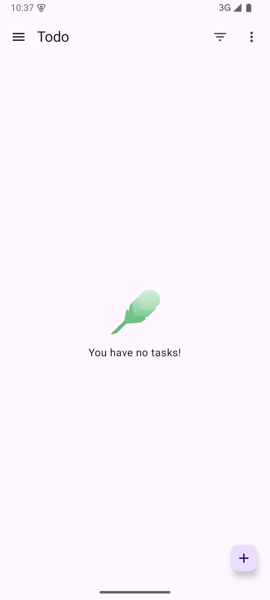
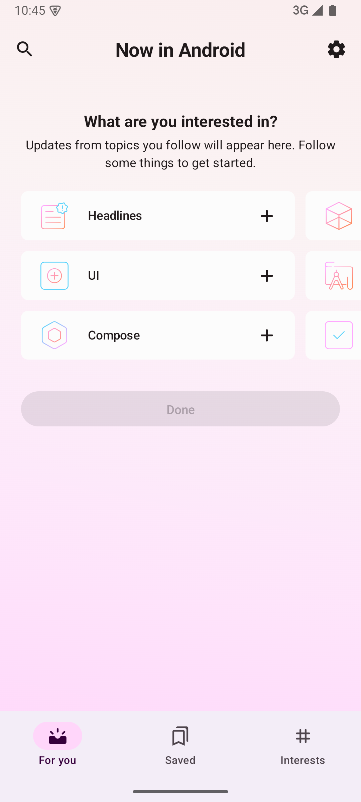

# #215 네이티브 Android baseline

## 현재 기록: 배포 archive 고정 후 새 실측

2026-10-16의 새 native baseline은 두 앱의 build/install/launch/첫 화면을 통과했다.
JDK 2개·SDK 8개·Gradle 2개의 정확한 archive와 source 입력을 먼저 고정했다.
실제 toolchain model은 build 중에 관측했다.
AGP 원본 Maven JAR 두 개의 checksum은 실측 전 cache 감사에 있었다.
공식 Maven checksum은 실측 후에 다시 관측했다. 두 관측 시점을 구분했다.
측정한 SDK/cache/source 보호 범위는 전후 같았다. 민감 파일은 stat만 비교했다.
전체 HOME와 기존 AVD 전체 bytes의 불변은 이 새 실측의 입증 범위가 아니다.

최신 판정과 실패·한계는 [pinned-baseline.md](./pinned-baseline.md)에 있다.
입력은 [pinned-inputs.json](./pinned-inputs.json)에 있다.
실행은 [pinned-runtime.json](./pinned-runtime.json)에 있다.
새 tuple과 별도 Runstir fresh clone 4개의 연결은 [fresh-runstir-handoff.json](./fresh-runstir-handoff.json)에 있다.
비공개 원본 293개와 새 AGP receipt의 연결은 [pinned-provenance.json](./pinned-provenance.json)에 있다.
선택한 원본 줄은 [pinned-excerpts.md](./pinned-excerpts.md)에 있다.
Runstir CLI·GUI와 #199 전체 완료는 이 native baseline 판정과 구분한다.

아래 기록은 2026-10-15의 이전 시도다. 당시의 `unknown`·`inconclusive`·실패를 보존했다.
이전 시도를 소급해서 archive가 고정된 성공으로 바꾸지 않았다.
경로 표시만 비식별 별칭으로 바꿨다. 과거 관측 사실은 바꾸지 않았다.
초기 PNG 3개의 별도 private 원본 위치는 여전히 `unknown`이다.
기존 공개 PNG 6개는 bytes 그대로 보존했다.

## 이전 기록: 작업 소유 SDK에서 첫 재실측 (2026-10-15)

두 앱의 build/install/launch/실제 첫 화면을 별도 SDK 복제본에서 다시 확인했다.
원본 SDK 124,165개 항목과 기존 AVD 41개 항목의 전체 regular file bytes·mode·size·mtime·symlink target이 종료 전후 같았다.
인증 파일은 내용이나 hash를 읽지 않고 stat만 비교했다. stat은 같았다.
이 재실측은 1차 시도의 `.knownPackages` 변경을 복원하지 않는다. 실패 이력은 아래에 보존한다.

| 표본 | 실제 compile SDK / Build Tools | 실행 JDK | build | 실제 첫 화면 |
| --- | --- | --- | --- | --- |
| To-do | `35` / `34.0.0` | `17.0.19` | exit `0`, 25.893초, 43 tasks | 빈 task 목록 |
| Now in Android | `36` / `36.0.0` | `21.0.12.1` | exit `0`, 15.488초, 551 tasks | 관심사 선택 화면 |

새 SDK·AVD·Gradle cache·임시 경로만 쓰도록 OS write guard를 적용했다.
실행 JDK는 기존 경로에서 읽었다. `HOME`과 전역 PATH는 바꾸지 않았다.
JVM `user.home`은 작업 소유 경로다. 자동 JDK/SDK provisioning을 금지했다.
Gradle 의존성 cache는 작업 소유 복제본이며 `--offline`을 사용했다.
두 APK의 설치 후 checksum은 각 빌드 산출물과 같았다.
Now in Android의 알림은 소유 AVD의 Android package manager로 거부했다.
이 준비는 사람의 알림 거부 클릭과 구분한다.
화면을 가린 알림과 orphan task, 재부팅 timeout, 관측용 init script의 두 실패를 기록했다.
실패 원인을 확정하지 않은 재부팅을 software renderer 원인으로 단정하지 않는다.

정확한 source·merged 앱 ID/launcher·command·device·보존·정리 근거는 [preservation-rerun.json](./preservation-rerun.json)에 있다.
별도 To-do/NIA fresh source clone을 각각 준비했다. source SHA와 tracked 상태를 확인했다.
fresh clone의 native build와 Runstir CLI/GUI는 실행하지 않았다.
소유 Emulator와 ADB `5043`을 정상 종료했다. 선택한 포트에는 listener가 없었다.

실제 실행은 통과했다. 입력 고정은 부분 완료다.
기존 JDK와 Android SDK의 원본 배포 archive identity/checksum이 아직 `unknown`이다.
설치된 파일 hash로 이 필수 입력을 대신하지 않는다. 전체 결과는 `inconclusive`이며 #215를 닫지 않는다.

## 이전 기록: 1차 시도와 실패 이력 (2026-10-15)

검증 날짜는 2026-10-15다. 명세는 [#199](https://github.com/minjunkim-dev/mobile-runtime/issues/199)다.
범위는 [#215](https://github.com/minjunkim-dev/mobile-runtime/issues/215)의 Runstir 없는 baseline이다.
두 표본의 실제 build/install/launch/첫 화면을 확인했다. 전체 결과는 `inconclusive`다.
기존 SDK의 `.knownPackages` metadata가 예상 밖으로 갱신됐다. 자원 보존 조건은 실패했다.
이 기록은 known-good 성공이나 AC05·AC06 전체 통과를 뜻하지 않는다. #215를 닫지 않는다.
정확한 명령·실패 이력·첫 화면은 [attempts.md](./attempts.md)에 있다.

## 고정한 표본

후보 출처는 [commit-pinned 조사](https://github.com/minjunkim-dev/mobile-runtime/blob/52ca6150685780cca86d5cb7c0b562033b40bd30/docs/research/cli-expansion-validation-candidates.md)다.
각 표본은 별도 disposable clone이다. source 선언과 tracked 파일을 수정하지 않는다.

| 항목 | 최소 역할 앱 | 실제 OSS 앱 |
| --- | --- | --- |
| 저장소 | [android/architecture-samples](https://github.com/android/architecture-samples) | [android/nowinandroid](https://github.com/android/nowinandroid) |
| source SHA | `ee66e1526b84c026615df032c705842b7d2a521f` | `a49ed253d75e61a2b6ab80a8da677b57437b08eb` |
| 앱 root / module / variant | `.` / `:app` / `debug` | `.` / `:app` / `demoDebug` |
| Gradle / AGP / Kotlin 선언 | `8.11.1` / `8.7.3` / `2.1.10` | `9.7.1` / `9.3.2` / `2.3.0` |
| compile / target / min SDK 선언 | `35` / `35` / `21` | `36` / `36` / `23` |
| 앱 Java/Kotlin compile target | `17` | `11` |
| build-logic compile target | 별도 build-logic 없음 | `17` |
| 실행 JDK | Zulu `17.0.19`, `Zulu17.66+19-CA`, ARM64 | Zulu `21.0.12.1`, `Zulu21.52+203-CA`, ARM64 |
| application ID source 추론 | `com.example.android.architecture.blueprints.main` | `com.google.samples.apps.nowinandroid.demo.debug` |
| launcher source 선언 | `com.example.android.architecture.blueprints.todoapp.TodoActivity` | `com.google.samples.apps.nowinandroid.MainActivity` |
| merged 앱 ID | `com.example.android.architecture.blueprints.main` | `com.google.samples.apps.nowinandroid.demo.debug` |
| merged launcher | `com.example.android.architecture.blueprints.todoapp.TodoActivity` | `com.google.samples.apps.nowinandroid.MainActivity` |
| build / 앱 실행 | exit `0`, 실제 첫 화면 확인 | exit `0`, 실제 첫 화면 확인 |
| baseline 결과 | `inconclusive`, SDK 보존 조건 실패 | `inconclusive`, SDK 보존 조건 실패 |

실행 JDK와 Java source target은 다르다. NIA의 `settings.gradle.kts`는 실행 JDK `17+`를 검사한다.
두 표본의 `.gradle.kts`·`.kt`·`.properties`에서 별도 `jvmToolchain`, Foojay resolver, daemon JVM criteria 선언을 찾지 못했다.
실제 build는 각각 위 실행 JDK와 wrapper Gradle로 완료했다. 자동 JDK/SDK 다운로드를 금지하는 옵션을 전달했다.
실행 JDK와 앱 compile target을 혼동하지 않았다. 정확한 resolved Build Tools 버전은 `unknown`이다.
추가 Gradle 관측으로 같은 공유 SDK를 다시 사용하지 않는다.

## 신뢰 검토와 수동 준비

1. 고정 SHA의 wrapper, settings, root/app build, version catalog, manifest, convention plugin을 읽었다.
2. 두 표본은 Google Maven, Maven Central, Gradle Plugin Portal을 사용한다.
3. NIA의 외부 process 호출은 `Badging.kt`의 선택 SDK `aapt2 dump badging`이다. tracked golden을 갱신하는 `update*Badging`은 실행하지 않는다.
4. NIA `demo`는 `DemoNiaNetworkDataSource`를 연결한다. 계정·API 비밀값 없이 첫 화면을 확인했다. 네트워크 차단 실험은 하지 않았다.
5. 계정·release signing·API 비밀값을 입력하지 않았다. 소유 clone의 debug APK만 대상으로 삼는다.

Gradle distribution은 wrapper가 작업 소유 `GRADLE_USER_HOME`에 내려받는다.
의존성 다운로드와 JDK/SDK provisioning을 구분한다.
사용자의 기존 SDK·cache·전역 PATH·기존 AVD를 변경하지 않는 조건으로 실행했다.
그러나 SDK cache-marker metadata 갱신을 관측했다. 이 조건을 충족했다고 주장하지 않는다.
Emulator는 별도 AVD home에 한 대만 생성했다. 공통 자원 lease를 받은 뒤 실행했다.

## host와 기존 자원

실제 Mac은 macOS `27.0.1` (`26A434`), `arm64`다.
SDK root는 `${EXISTING_SDK}`다.
기존 JDK `17.0.19`, `21.0.12.1`을 절대경로로 선택한다.
기존 SDK Platform `35` revision `2`와 `36` revision `2`가 있다.
기존 Build Tools `35.0.0`와 `36.0.0`이 있다.
Emulator는 `37.1.11` build `15917651`이다. platform-tools는 `37.0.1`이다.
기존 API `35` Google APIs ARM64 image revision `9`를 실행 후보로 고정했다.
image identity는 `system-images;android-35;google_apis;arm64-v8a`다.
이 값은 설치된 package metadata다. 원본 SDK/JDK 다운로드 archive checksum은 `unknown`이다.
설치된 파일 checksum은 [inputs.json](./inputs.json)에 별도 기록했다.

실행 전 `ps -axo pid,ppid,comm`의 정확한 실행 파일 이름으로 emulator·qemu·adb·java·gradle·sdkmanager를 확인했다.
해당 프로세스는 없었다. lease 시점에 같은 프로세스와 포트를 다시 확인했다.
기존 `Pixel_10_API_37_Play` AVD는 사용하지 않는다.
기존 자원 metadata digest는 entry의 상대경로·종류·mode·size·mtime_ns·symlink target을 정렬해서 계산했다.
이 digest는 전체 자원 byte checksum이 아니다. 실행 후 동일한 관측으로 비교했다.
SDK entry 수와 총 byte 수는 같았다. SDK metadata digest는 달랐다.
최근 수정 경로 조사에서 `.knownPackages` 하나를 관측했다. 원래 이 파일의 bytes와 개별 mtime은 수집하지 않았다.
따라서 SDK 전체 byte 보존이나 marker 내용의 보존을 증명하지 않는다. 자동 복원도 하지 않았다.
실행 전 고정한 SDK 파일 11개는 실행 후 byte checksum이 같았다.
기존 AVD의 entry 수·총 byte 수·metadata digest는 실행 전후 같았다.
두 표본의 전체 tracked byte/mode digest와 index 상태도 실행 전후 같았다.
소유 Emulator와 ADB `5041` 서버를 정상 종료했다. `5037`·`5041`·`5560`·`5561` listener가 없었다.

## 완료 판정과 인계

| 수용 기준 | 필요한 증거 | 현재 상태 |
| --- | --- | --- |
| #215 입력 고정 | source·module/variant·실제 merged 앱 ID/launcher·실행 JDK/Gradle/AGP·SDK/image·기기 identity | 위 표와 inputs.json에 고정. resolved Build Tools는 `unknown` |
| #215 하위 toolchain 확인 | source target과 실행 JDK 구분, 실제 resolution 관측 | 서로 다른 target/JDK를 기록. 새 JDK/SDK 자동 다운로드 금지 옵션 전달. build 완료 |
| #215 실제 baseline / AC05 일부 | 두 표본 build/install/launch/첫 화면, source/resource 전후 비교 | 두 앱 첫 화면·source 보존 확인. SDK 보존 조건 실패 |
| #215 실패·수동 준비·fresh clone | 실패 이력 보존, baseline 후 독립 fresh clone | 실패·알림 거부·화면을 보존. To-do fresh source clone만 준비. 유효 baseline 인계는 보류 |
| AC06 실제 Mac Android 가속 | 실제 Mac 가속 확인과 Emulator 실행 | 실제 Mac의 HVF 가용성 exit `0`과 실제 ARM64 guest 실행 확인. runtime acceleration 진단 로그는 미수집 |

AC05의 Runstir CLI·GUI 실행은 후속 티켓 범위다.
AC06의 기준 VM 준비 결과는 이 실제 Mac 기록으로 대신하지 않는다.
Android 실기기는 검증하지 않았다.
To-do의 별도 fresh source clone은 같은 source SHA와 119개 tracked digest를 유지한다. 생성 산출물은 없다.
그러나 자원 보존 실패 때문에 이 clone을 known-good baseline 인계로 승인하지 않는다.
NIA fresh clone은 아직 만들지 않았다.
다음 실측은 작업 소유 SDK root와 별도 AVD를 사용해야 한다. 원본 SDK write 금지를 강화해야 한다.
baseline clone의 Gradle 산출물·cache·APK를 fresh clone에 복사하지 않는다.
실패·inconclusive·부적격 결과를 삭제하지 않는다.

## 문서 검증

`git diff --check`와 `python3 scripts/check_bugbot_rules.py`가 통과했다.
JSON parse, 두 source manifest의 전후 동일성, 세 PNG의 SHA-256·크기·1080×2400 image header, 로컬 문서 참조를 검사했다.
이 검사는 증거 파일의 일관성 검사다. 미완료 baseline이나 실제 Runstir 실행을 대신하지 않는다.
