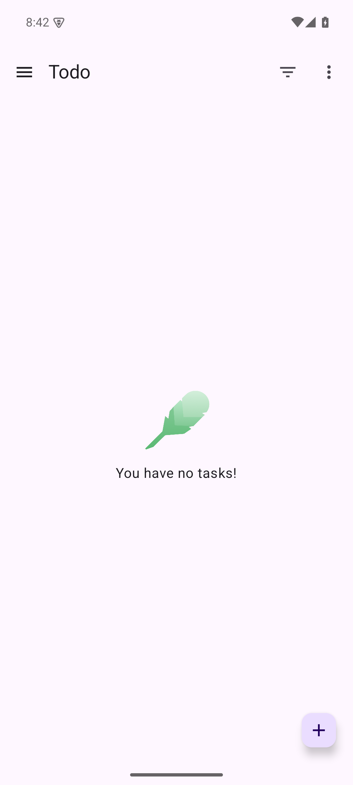
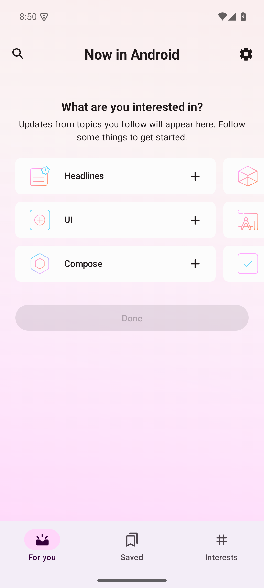

# 실행 이력

모든 명령은 Runstir를 사용하지 않았다. 작업 root는 `${INITIAL_ROOT}`다.
원본 실행 로그는 이 root의 `logs/`에 보존한다. 자격 파일과 전체 환경값을 공개 증거에 복사하지 않는다.
공개 명령의 `${JDK17_HOME}`과 `${JDK21_HOME}`은 각각 기존 Zulu `17.0.19`와 `21.0.12.1`의 설치 경로 별칭이다.
실제 사용자 경로는 비공개 원본에만 보존한다.

## A1: To-do build

고정 source는 `ee66e1526b84c026615df032c705842b7d2a521f`다.
`todo-baseline/`에서 다음 명령을 실행했다.

```sh
env ANDROID_HOME=${EXISTING_SDK} \
  ANDROID_SDK_ROOT=${EXISTING_SDK} \
  ANDROID_USER_HOME=${INITIAL_ROOT}/android-user \
  GRADLE_USER_HOME=${INITIAL_ROOT}/gradle-todo \
  JAVA_HOME=${JDK17_HOME} \
  ./gradlew --no-daemon --console=plain \
  -Dorg.gradle.java.installations.auto-download=false \
  -Pandroid.builder.sdkDownload=false :app:assembleDebug
```

결과는 exit `0`이다. Gradle은 `BUILD SUCCESSFUL in 6m 4s`와 `43 actionable tasks: 43 executed`를 반환했다.
원본 경고를 수정하지 않았다. Gradle script deprecation, unresolved `kotlin.Experimental`, Accompanist deprecation, Jetifier 경고가 있었다.
Gradle daemon의 실제 JDK는 Zulu `17.0.19`다.
Kotlin compiler daemon은 이번 Gradle의 child로 생성됐다. 이 daemon은 사용자 Kotlin daemon 디렉터리에 run metadata를 뒀다.
컴파일러·의존성 cache는 작업 소유 `gradle-todo/`에 있었다. daemon은 build 완료 후 스스로 종료했다.
후속 TERM 시도는 `no such process`를 반환했다. 기존 프로세스를 종료하지 않았다.
debug keystore는 작업 소유 `android-user/`에 생성됐다. keystore 내용은 수집하지 않았다.

산출물은 `todo-baseline/app/build/outputs/apk/debug/app-debug.apk`다.
크기는 `24681593` byte다. SHA-256은 `26a970c286b4edad3c824209cec99a82c918b74c482cd1a91b8f610590b25fe0`다.
실제 `output-metadata.json`은 `:app`의 `debug`와 단일 APK를 확인했다.
SDK Build Tools `35.0.0/aapt2 dump badging`은 exit `0`으로 다음 값을 확인했다.

```text
package: name='com.example.android.architecture.blueprints.main' versionCode='1' versionName='1.0' platformBuildVersionName='15' platformBuildVersionCode='35' compileSdkVersion='35' compileSdkVersionCodename='15'
targetSdkVersion:'35'
application-label:'Todo'
launchable-activity: name='com.example.android.architecture.blueprints.todoapp.TodoActivity'  label='' icon=''
```

이 `aapt2` 버전은 APK 관측 도구다. Gradle이 사용한 Build Tools 버전으로 소급하지 않는다.

## E1: window Emulator 시도

설치된 command-line tools는 revision `21.0`이다. `latest` 디렉터리의 실제 package identity를 확인했다.
새 AVD는 `avdmanager create avd --name runstir215-api35 --package 'system-images;android-35;google_apis;arm64-v8a' --path <작업 root>/avd/runstir215-api35.avd --device pixel_7`로 만들었다.
`ANDROID_AVD_HOME`, `ANDROID_USER_HOME`, `ANDROID_EMULATOR_HOME`은 작업 소유 경로다.
기존 AVD를 복사하거나 변경하지 않았다.

실행 직전 emulator·qemu·adb·java·gradle·sdkmanager 프로세스와 TCP `5037`, `5041`, `5560`, `5561` listener가 없었다.
`emulator -accel-check`는 exit `0`과 `Hypervisor.Framework OS X Version 27.0`을 반환했다.
공식 `adb help`의 `-P`, `-L`과 [ADB 공식 source의 socket 환경 선택](https://android.googlesource.com/platform/packages/modules/adb/+/refs/heads/main/client/commandline.cpp)을 확인했다.
새 ADB 서버는 `adb -L tcp:localhost:5041 start-server`로 만들었다. 서버 PID는 `54724`다.
`server-status`는 platform-tools `37.0.1`, build `15733141`을 확인했다.
이 서버는 별도 Android home과 관계없이 사용자의 기존 key 경로를 보고했다. key 내용은 읽지 않았다.
기본 ADB `5037`에는 listener가 없었다. 기본 ADB를 시작하거나 종료하지 않았다.

Emulator의 정확한 옵션은 다음과 같다.

```sh
env ANDROID_HOME=${EXISTING_SDK} \
  ANDROID_SDK_ROOT=${EXISTING_SDK} \
  ANDROID_USER_HOME=${INITIAL_ROOT}/android-user \
  ANDROID_EMULATOR_HOME=${INITIAL_ROOT}/android-user \
  ANDROID_AVD_HOME=${INITIAL_ROOT}/avd \
  ADB_SERVER_SOCKET=tcp:localhost:5041 ANDROID_ADB_SERVER_PORT=5041 \
  ${EXISTING_SDK}/emulator/emulator \
  @runstir215-api35 -port 5560 -no-snapshot -no-audio -no-boot-anim \
  -gpu swiftshader -no-direct-adb \
  -adb-path ${EXISTING_SDK}/platform-tools/adb -no-metrics
```

qemu PID는 `54841`이었다. 이 PID가 console `5560`과 ADB `5561`을 소유했다.
guest `sys.boot_completed=1`을 관측했다. 그러나 host `DisplaySurfaceGl` window 생성 오류가 있었다.
이 시도에서 앱을 설치하거나 첫 화면 성공을 선언하지 않았다. 결과는 `inconclusive`다.
`adb -P 5041 -s emulator-5560 emu kill`은 즉시 응답하지 않았다.
PID의 AVD 이름과 `-port 5560` 일치를 재확인한 뒤 해당 PID에만 SIGTERM을 보냈다.
PID와 두 listener의 소멸을 확인했다. 원본 로그는 `emulator-attempt1-window.log`다.

## E2: headless Emulator와 To-do 첫 화면

E1과 같은 AVD에 `-no-window`를 추가했다. 다른 Emulator는 실행하지 않았다.
원본 로그는 `emulator-attempt2-headless.log`다.
guest는 `sys.boot_completed=1`, Android `15`, API `35`, `arm64-v8a`를 반환했다.
build fingerprint는 `google/sdk_gphone64_arm64/emu64a:15/AE3A.240806.043/12960925:userdebug/dev-keys`다.

첫 `adb -P 5041 -s emulator-5560 install -r <To-do APK>`는 exit `1`이었다.
오류는 `cmd: Failure calling service package: Broken pipe (32)`다.
guest crash buffer에 20:38:50~52 `DeadSystemException`이 있었다.
이는 앱 설치 전 system death다. To-do 앱의 결함으로 귀속하지 않는다. 원인은 `unknown`이다.
20:39:55에는 guest Bluetooth native crash도 있었다. 이 이력을 삭제하지 않는다.
host는 48 GiB memory와 free `37%`를 보고했다. host OOM을 입증하지 않는다.

`cmd package list packages -3`의 exit `0`과 빈 결과를 확인했다.
같은 APK의 `install -r` 재시도는 exit `0`과 `Success`를 반환했다.
삭제·초기화·다른 APK 교체는 수행하지 않았다.

```sh
adb -P 5041 -s emulator-5560 shell am start -W -n \
  com.example.android.architecture.blueprints.main/com.example.android.architecture.blueprints.todoapp.TodoActivity
```

위 명령은 exit `0`, `Status: ok`, `LaunchState: COLD`, `TotalTime: 7777`, `WaitTime: 8343`, `Complete`를 반환했다.
앱 PID는 `4805`다. `dumpsys activity activities`의 `topResumedActivity`는 같은 앱 ID와 `TodoActivity`다.
`pm path`는 해당 앱의 설치된 `base.apk`를 확인했다.
실제 `adb exec-out screencap -p`의 PNG를 직접 열었다.
`Todo`, `You have no tasks!`, 추가 버튼을 확인했다. crash dialog나 빈 화면이 아니었다.



To-do build/install/launch/첫 화면의 관측은 완료했다.
source/resource 보존 최종 감사 전에는 #215 전체 완료로 세지 않는다.

## A2: Now in Android build와 첫 화면

고정 source는 `a49ed253d75e61a2b6ab80a8da677b57437b08eb`다.
`nia-baseline/`에서 다음 명령을 실행했다. A1의 build 종료 후 시작했다.

```sh
env ANDROID_HOME=${EXISTING_SDK} \
  ANDROID_SDK_ROOT=${EXISTING_SDK} \
  ANDROID_USER_HOME=${INITIAL_ROOT}/android-user \
  GRADLE_USER_HOME=${INITIAL_ROOT}/gradle-nia \
  JAVA_HOME=${JDK21_HOME} \
  ./gradlew --no-daemon --console=plain \
  -Dorg.gradle.java.installations.auto-download=false \
  -Pandroid.builder.sdkDownload=false \
  -Pkotlin.compiler.execution.strategy=in-process :app:assembleDemoDebug
```

결과는 exit `0`이다. Gradle `9.7.1`은 `BUILD SUCCESSFUL in 22m 35s`를 반환했다.
작업은 `551 actionable tasks: 468 executed, 83 from cache`다. 이 cache는 이번 소유 Gradle home에 있다.
원본 lint/Kotlin annotation 경고와 ASM의 optional tooling/window class 미해결 경고를 보존했다.
원본 source를 수정해서 경고를 없애지 않았다.
실행 JDK는 Zulu `21.0.12.1`이다. 앱 compile target `11`과 build-logic compile target `17`을 구분했다.
추가 JDK provisioning 선언을 찾지 못했다. 새 JDK/SDK 다운로드 금지 옵션을 전달한 build가 완료됐다.

산출물은 `nia-baseline/app/build/outputs/apk/demo/debug/app-demo-debug.apk`다.
크기는 `37209116` byte다. SHA-256은 `2b1b3d7e70bdd9a2db09e2492af597b042676229cc5f61f46ad679b0d4e82c31`다.
실제 output metadata는 `demoDebug`와 단일 APK를 확인했다.
SDK Build Tools `36.0.0/aapt2 dump badging`은 exit `0`으로 다음 값을 확인했다.

```text
package: name='com.google.samples.apps.nowinandroid.demo.debug' versionCode='8' versionName='0.1.2' platformBuildVersionName='16' platformBuildVersionCode='36' compileSdkVersion='36' compileSdkVersionCodename='16'
targetSdkVersion:'36'
application-label:'Now in Android'
launchable-activity: name='com.google.samples.apps.nowinandroid.MainActivity'  label='' icon=''
```

이 `aapt2` 버전은 APK 관측 도구다. Gradle이 사용한 Build Tools 버전으로 소급하지 않는다.
같은 E2 Emulator에 `adb -P 5041 -s emulator-5560 install -r <NIA APK>`를 실행했다.
결과는 exit `0`과 `Success`다. 기존 To-do와 다른 앱 ID를 사용했다.
정확한 launcher는 다음 명령으로 실행했다.

```sh
adb -P 5041 -s emulator-5560 shell am start -W -n \
  com.google.samples.apps.nowinandroid.demo.debug/com.google.samples.apps.nowinandroid.MainActivity
```

첫 응답은 exit `0`이지만 `Status: timeout`과 `GrantPermissionsActivity`를 반환했다.
이는 첫 화면 성공 증거가 아니다. 실제 PNG에서 알림 권한 대화상자를 확인했다.
화면의 `Don't allow`를 `adb shell input tap 540 1470`으로 선택했다.
알림 권한을 허용하거나 계정을 입력하지 않았다.
원본 권한 화면은 [nia-notification-prompt.png](./nia-notification-prompt.png)에 보존했다.

같은 launcher를 다시 요청한 결과는 exit `0`, `Status: ok`, `WaitTime: 6`, `Complete`다.
`Activity not started, intent has been delivered to currently running top-most instance` 경고도 보존했다.
실제 앱 PID는 `6151`이다. `topResumedActivity`는 정확한 NIA 앱 ID와 `MainActivity`다.
실제 설치된 `base.apk`의 SHA-256은 생성한 APK와 같았다.
해당 PID의 crash buffer는 관측 시점에 비었다.
실제 guest PNG를 직접 열었다. `Now in Android`, `What are you interested in?`, `Headlines`, `UI`, `Compose`를 확인했다.
crash dialog나 빈 화면이 아니었다. 첫 화면 이후의 기능은 검증하지 않았다.



## 보존 감사와 결과

| 대상 | 실행 전후 관측 | 판정 |
| --- | --- | --- |
| To-do source | 119개 tracked byte/mode digest `0bfd7c5d531a0bc7da899b3f576725ace0ab539f83b779d712e4b2fbbbeff442` 동일. source SHA 동일. git status 빈 값 | source 보존 확인 |
| NIA source | 715개 tracked byte/mode digest `0f2774e653ad51c31688ee6f01169636eb604dd467d986f8cd9d17cbe5de548a` 동일. source SHA 동일. git status 빈 값 | source 보존 확인 |
| 기존 AVD | 41개 entry, `11436031608` byte, metadata digest `179d09b9d0cb3bef5e43baeba0b9dfd767a8b9e545a183e94c4c95cba3fb51f7` 동일 | metadata 보존 확인. 전체 byte 미수집 |
| 공유 SDK | 124165개 entry, `21418313928` byte 동일. metadata digest `1507bd0d623d9f7effaec459eaa9024bffed014c4886390579a736a4dabd9fd6` → `346313ed8ab549adc290461692b1fa2cd00b612ed278a128d7ef1d01f32a5af6` | 보존 조건 실패 |
| 선택 SDK 파일 | emulator·adb·SDK35/36 android.jar·35/36 aapt2·API35 image metadata/system/vendor/kernel/ramdisk, 총 11개 byte SHA-256 동일 | 이 11개만 byte 보존 확인 |

공유 SDK의 최근 mtime 조사에서 `.knownPackages` 하나를 관측했다.
이 파일은 16 byte다. 관측한 mtime은 `2026-10-15 20:23:04 Asia/Seoul`이다.
현재 SHA-256은 `c9e4213c80f2816dca9959705fb17cdfd4f175a982bd2450966581a4a952dbde`다.
호출별 쓰기 추적은 수집하지 않았다. 특정 Gradle/avdmanager 호출에 원인을 귀속하지 않는다.
원래 이 파일의 bytes와 개별 mtime을 수집하지 않았다. 원래 bytes가 같았다고 주장하지 않는다.
이 파일을 자동 복원하지 않았다. SDK 전체 bytes 보존도 증명하지 않는다.
새 JDK/SDK 다운로드 금지 옵션만으로 SDK cache-marker write까지 막았다고 판단할 수 없다.
이 관측 후 같은 공유 SDK에서 Gradle·avdmanager·sdkmanager를 추가 실행하지 않았다.

두 앱의 build/install/launch/첫 화면은 관측했다. 그러나 자원 보존 조건을 충족하지 못했다.
따라서 전체 baseline은 `inconclusive`다. #215와 AC05·AC06를 완료로 표시하지 않는다.
정확한 resolved Build Tools 버전과 실제 실행 acceleration 진단도 미수집 상태다.
다음 실측은 작업 소유 SDK root와 별도 AVD를 사용해야 한다. 원본 SDK write 금지를 강화해야 한다.

## fresh source와 종료

To-do의 첫 화면 확인 후 원격에서 별도 `todo-runstir-fresh/`를 clone했다.
같은 source SHA와 119개 tracked digest를 확인했다. `.gradle`, `.kotlin`, `app/build`, `local.properties`는 없다.
source만 준비했다. baseline 자원 보존 실패 때문에 유효 known-good 인계는 보류한다.
NIA fresh clone은 아직 없다. baseline 산출물·의존성 cache·APK를 fresh clone에 복사하지 않았다.

종료 전 ADB `5041`에는 소유 `emulator-5560` 한 대만 있었다.
`lsof`의 `5041` listener는 이번 서버 PID `54724`였다. 다른 연결은 관측하지 못했다.
`adb -P 5041 -s emulator-5560 emu kill`은 `OK: killing emulator, bye bye`를 반환했다.
headless Emulator PID `84720`의 exit `0`을 확인했다.
device 목록이 빈 것을 확인한 뒤 소유 ADB `5041` 서버만 `kill-server`로 종료했다.
기본 ADB `5037`을 종료하지 않았다. 최종 `5037`·`5041`·`5560`·`5561` listener는 없었다.
lease를 반납했다. 소유 source clone·Gradle cache·AVD·APK·원본 로그는 작업 root에 보존했다.
원본 로그와 PNG의 파일 크기·SHA-256은 [inputs.json](./inputs.json)에 기록했다.
