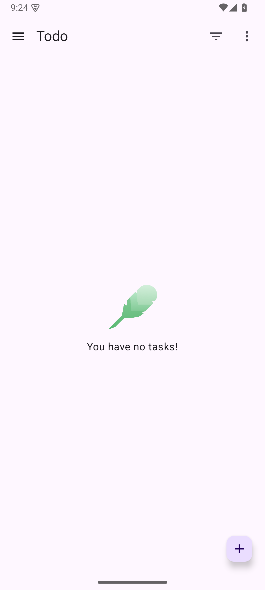
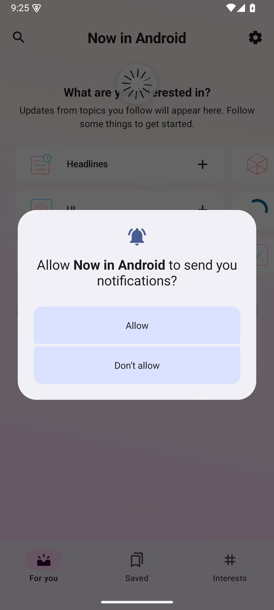
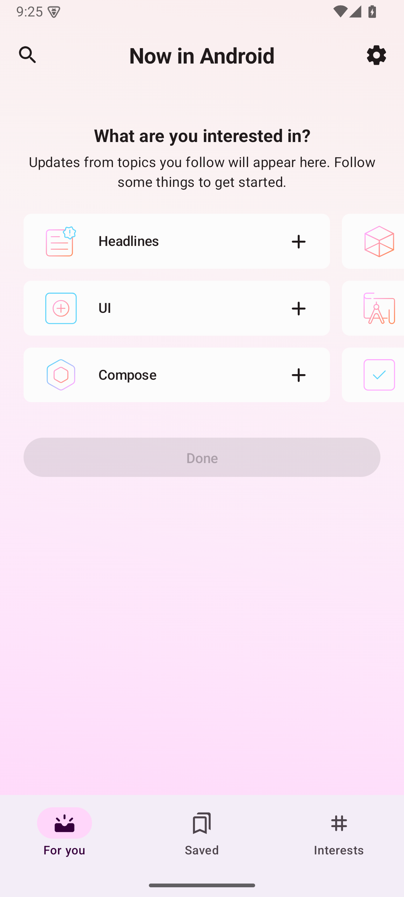

# 배포 archive를 고정한 새 네이티브 Android baseline

검증 날짜는 2026-10-16이다. 두 표본의 native build/install/launch/첫 화면을 확인했다.
측정한 baseline과 보호 자원 비교는 `PASS`다. Runstir CLI·GUI는 실행하지 않았다.
이 결과는 #199 전체 표본, 기준 VM, Android 실기기, 정식 배포의 완료 판정이 아니다.
이 문서 작성 시점에 PR·CI·병합·issue 완료 절차는 별도 gate다.

이 실측은 아래의 1차 시도와 첫 재실측을 대체하지 않는다.
이전 시도를 소급해서 archive가 고정된 성공으로 바꾸지 않는다.
기존 `.knownPackages` 변경과 `inconclusive` 판정은 이력으로 남긴다.

## 고정 입력과 실제 실행

| 항목 | To-do | Now in Android |
| --- | --- | --- |
| 저장소 | [android/architecture-samples](https://github.com/android/architecture-samples) | [android/nowinandroid](https://github.com/android/nowinandroid) |
| source SHA | `ee66e1526b84c026615df032c705842b7d2a521f` | `a49ed253d75e61a2b6ab80a8da677b57437b08eb` |
| root / module / variant | `.` / `:app` / `debug` | `.` / `:app` / `demoDebug` |
| task | `:app:assembleDebug` | `:app:assembleDemoDebug` |
| 실제 Gradle / AGP | `8.11.1` / `8.7.3` | `9.7.1` / `9.3.2` |
| 실제 compile SDK / Build Tools | `35` / `34.0.0` | `36` / `36.0.0` |
| 실제 daemon JDK | Azul `17.0.19+10-LTS`, `aarch64` | Azul `21.0.12.1+1-LTS`, `aarch64` |
| build | exit `0`, 25.058초, 43 tasks 실행 | exit `0`, 13.458초, 551 tasks 중 235 실행·316 cache |
| APK bytes | 24,681,592 | 37,211,209 |
| 실제 package | `com.example.android.architecture.blueprints.main` | `com.google.samples.apps.nowinandroid.demo.debug` |
| 실제 launcher | `com.example.android.architecture.blueprints.todoapp.TodoActivity` | `com.google.samples.apps.nowinandroid.MainActivity` |
| 앱 PID | `3726` | `4148` |
| 첫 화면 | `Todo`의 빈 task 목록 | `Now in Android`의 관심사 선택 화면 |

JDK 2개, Android SDK package 8개, Gradle 2개의 원본 archive를 먼저 고정했다.
12개 archive의 실제 합계는 `3,314,484,326` bytes다.
공식 URL·revision·provider checksum·size와 실제 archive SHA256은 [pinned-inputs.json](./pinned-inputs.json)에 있다.
구성 전과 종료 후에 archive의 member bytes·mode·link target을 설치 내용과 비교했다.
이 비교는 12개 모두 통과했다.

AGP는 원본 Maven JAR을 별도로 확인했다.
변환된 Gradle cache JAR이나 설치된 SDK binary를 배포 archive 대신 쓰지 않았다.

| Maven coordinate | 원본 JAR bytes | SHA256 |
| --- | --- | --- |
| `com.android.tools.build:gradle:8.7.3` | `12429787` | `abb4f9e92c9838bd9989ba05968ec892189e16e23f42adba2e063843da04070d` |
| `com.android.tools.build:gradle:9.3.2` | `13156012` | `f3a1004508daeb00c4535bd56207c7ec2f958a40d7543466379e4de6bb947873` |

이 두 SHA256은 build 시작 전의 원본 cache 감사에 이미 있었다.
원본 cache, 종료 후 cache, 실제 사용한 COW cache JAR이 같은 SHA256을 보였다.
공식 Google Maven의 `.jar.sha1`·`.jar.sha256`·HEAD는 실측 후에 다시 관측했다.
공식 값은 원본 JAR과 일치했다. 이 공식 metadata를 실측 전에 받은 것으로 쓰지 않는다.
정확한 상대 cache 경로와 관측 시각은 [pinned-inputs.json](./pinned-inputs.json)에 있다.
두 source에는 tracked `verification-metadata.xml`이 없다.
이 감사는 AGP main JAR 두 개를 연결한다. 모든 전이 Maven 의존성의 독립 검증을 뜻하지 않는다.

## 구성과 자원 경계

새 JDK는 공식 archive의 표준 `Contents/Home` 구조를 유지했다.
JDK17의 regular file 374개·link 214개와 JDK21의 regular file 336개·link 205개를 비교했다.
기존 mise 설치의 flattening·추가 self-link·link mode 차이는 별도 실패 이력으로 남겼다.
그 기존 설치에 대한 strict layout/mode 비교는 `FAIL`이다.
이번 새 표준 설치의 동일성 결과와 그 과거 `FAIL`을 구분한다.

SDK의 generated `package.xml` 8개는 배포 ZIP에 없다.
기존 local metadata를 별도 입력으로 복사했다. 전후 bytes는 같았다.
기존 license record도 그대로 복사했다. 새 license 수락은 `0`회다.
`cmdline-tools;21.0`은 정확한 archive를 사용했다.
소유 SDK의 `cmdline-tools/latest`는 복사한 local metadata 경로와 맞춘 위치다.
현재 remote `latest`를 선택하거나 다운로드한 결과가 아니다.

두 source clone과 Gradle cache 복제본은 작업 소유 경로에 있다.
원본 source·SDK·cache는 쓰지 않도록 OS write guard를 적용했다.
child `HOME`, JVM `user.home`, Android home, AVD home, cache와 임시 경로는 소유 경로다.
host의 전역 `HOME`과 PATH는 변경하지 않았다.
검증된 Gradle distribution 실행 파일을 직접 호출했다. wrapper는 호출하지 않았다.
`--offline`과 JDK·SDK 자동 다운로드 금지 옵션을 전달했다.
정확한 argv·환경 별칭은 [pinned-runtime.json](./pinned-runtime.json)에 있다.
모델·build·focus·종료 로그의 줄 발췌는 [pinned-excerpts.md](./pinned-excerpts.md)에 있다.

새 AVD 한 대만 실행했다. Pixel 7 profile과 API35 Google APIs ARM64 revision9를 사용했다.
화면은 `1080×2400`, density `420`이다. RAM은 2 GiB다.
Emulator `37.1.11` build `15917651`에 `-accel on -gpu swiftshader -no-window`를 전달했다.
실제 Mac에서 Hypervisor.Framework 가용성 probe는 exit `0`이었다.
guest의 boot 완료와 API·ABI를 직접 확인했다.
소유 ADB는 `5044`, console은 `5566`, transport는 `5567`이다.
이 번호는 작업 소유 endpoint다. 물리 기기 ID가 아니다.

## 첫 화면과 APK 연결

두 APK를 직접 설치했다. 설치한 `base.apk` SHA256은 각 빌드 APK와 같았다.
앱 PID와 실제 activity focus를 확인했다. ADB `exec-out screencap -p` bytes를 저장했다.
세 PNG를 직접 열어 확인했다. 아래 PNG는 원본 bytes 그대로다.
새 캡처를 만들거나 이미지를 편집하지 않았다.
원본·공개 PNG의 SHA256 연결은 [pinned-provenance.json](./pinned-provenance.json)에 있다.

NIA의 첫 관측은 알림 권한 prompt였다. 이 prompt만으로 첫 화면을 통과시키지 않았다.
관측한 `Don’t allow` 버튼을 소유 guest의 정상 UI 입력으로 눌렀다.
그 뒤 앱 focus와 관심사 선택 화면을 다시 확인했다.
이 입력은 SDK license 수락과 무관하다.

## 보존 판정

| 원본 보호 범위 | 항목 수 | content SHA256 비교 파일 | stat-only 파일 | 전후 차이 |
| --- | ---: | ---: | ---: | --- |
| 기존 SDK | 124,165 | 104,472 | 6 | 0 |
| 이전 To-do Gradle cache | 27,023 | 14,516 | 6 | 0 |
| 이전 NIA Gradle cache | 56,229 | 32,353 | 8 | 0 |
| 전역 Gradle cache | 715,568 | 441,356 | 930 | 0 |
| 전역 Android home | 13 | 0 | 10 | 0 |
| 기존 console 인증 파일 | 단일 파일 | 0 | 1 | 0 |
| 원본 To-do source | 119 tracked | 119 | 0 | 0 |
| 원본 NIA source | 715 tracked | 714 | 0 | 0 |

regular file의 SHA256과 관측한 mode·size·mtime·symlink target을 비교했다.
NIA의 tracked 715개는 regular file 714개와 symlink 1개다. symlink는 target·mode를 비교했다.
민감 파일은 내용이나 hash를 읽지 않았다. stat만 비교했다.
특히 전역 Gradle cache의 stat-only 930개를 content checksum 비교에 포함하지 않는다.
stat-only 파일의 bytes 불변은 입증하지 않았다.
원본 source의 HEAD·raw index bytes/stat·stage·flags도 같았다.
작업 소유 source의 tracked 119개·715개와 raw index·stage·flags도 같았다.
Git 조회에는 `GIT_OPTIONAL_LOCKS=0`을 사용했다.

기존 AVD는 부팅하지 않았다. 전역 Android home 감사는 관측한 경로의 stat 범위다.
이 새 실측은 기존 AVD 전체 파일 bytes의 불변을 별도로 주장하지 않는다.
전체 `HOME` 불변도 측정하거나 주장하지 않는다.
첫 ADB 실패 시각 뒤에 전역 HOME의 OS 진단 `.ips` 하나를 stat으로 관측했다.
내용·hash를 읽지 않았다. 원인을 확정하지 않았다. 복원하거나 삭제하지 않았다.

원본 before/after snapshot의 이름과 SHA256은 [pinned-provenance.json](./pinned-provenance.json)에 있다.
큰 raw 감사 파일은 공개하지 않는다. 비공개 원본은 그대로 보존했다.
비공개 index는 293개 증거를 가리킨다. 이 293개를 다시 hash 검사했다.
AGP 후속 연결 receipt는 그 index에 포함되지 않은 추가 증거다.
기존 index를 덮어써서 AGP가 처음부터 그 293개에 있었다고 만들지 않았다.

## 실패 이력과 종료

### 별도 Runstir fresh clone 인계

새 baseline의 archive 12개·source tuple과 같은 입력을 별도 Runstir 검증 경로에 연결했다.
각 앱의 CLI·GUI용 source를 `--no-hardlinks --no-checkout`으로 새로 복제한 뒤 정확한 SHA를 checkout했다.
native baseline의 build 산출물이나 source 작업 폴더를 복사하지 않았다.
4개 source의 tracked bytes·mode·symlink target은 native source와 같았다.
각 raw index·stage·flags와 명시적 사용자 선택 `mobile.yml`을 첫 Runstir 검사 전에 기록했다.
Gradle wrapper의 regular file 314개·712개도 같은 공식 archive와 비교했다.
모든 fresh snapshot 시각은 첫 Runstir command보다 앞선다.
이 인계 시점의 fresh 상태와 이후 #211의 실행 결과는 구분한다. 현재도 미사용이라고 주장하지 않는다.
정확한 source·시각·index·snapshot hash와 비공개 receipt 17개의 연결은 [fresh-runstir-handoff.json](./fresh-runstir-handoff.json)에 있다.
이 추가 handoff receipt는 native 증거 index 293개를 덮어쓰거나 그 안에 소급 추가하지 않는다.

1. 첫 before 감사의 마지막 process 조회는 write guard 안에서 `EPERM`으로 끝났다. 자원 snapshot 8개는 이미 저장돼 있었다. process 조회만 guard 밖의 read-only 관측으로 분리했다. 쓰기 허용 범위를 넓히지 않았다.
2. ADB 첫 시도는 `-L tcp:127.0.0.1:5044`를 거부했다. 오류는 `listening on specified hostname currently unsupported`다. ADB는 `SIGABRT`, exit `-6`으로 끝났다. Emulator는 시작하지 않았다. listener 부재를 확인했다.
3. 승인받은 단일 infra 교정으로 `adb -P 5044 --one-device emulator-5566 server nodaemon`을 사용했다. child `ADB_SERVER_SOCKET`은 `tcp:5044`다. host 전역 환경이나 기본 ADB `5037`은 바꾸지 않았다.
4. To-do의 처음 `dumpsys window windows` 결과에는 global focus가 없었다. 빈 focus receipt는 보존했다. 별도 전체 window/activity 조회로 실제 focus를 보완했다.
5. AVD helper의 `existingAVDUnchanged=true`는 구현 의도였다. 완료된 보존 측정으로 쓰지 않도록 별도 correction receipt를 남겼다. 실제 before/after 감사를 판정 근거로 삼았다.
6. 소유 Emulator PID `77629`와 소유 foreground ADB PID `77479`를 정상 종료했다. 두 실제 종료 코드는 `0`이다. manager도 exit `0`이었다. 최종 `5037`·`5044`·`5566`·`5567` listener와 관련 native process는 없었다. 자원 lease를 반환했다.

Azul API의 size와 실제 CDN/다운로드 size가 다르다.
JDK17은 API보다 28 bytes 크다. JDK21은 API보다 315 bytes 작다.
API가 반올림한다고 규정한 근거는 없다. 이 차이의 원인은 `unknown`이다.
정확한 CDN size와 provider SHA256을 별도 고정하고 승인된 범위에서 실제 archive를 검증했다.
Azul OpenPGP 서명은 검증하지 않았다.

NIA의 316개 task는 복제 cache에서 재사용했다. 모든 compile 작업을 새로 수행했다고 주장하지 않는다.
초기 PNG 3개의 별도 private 원본 위치는 여전히 `unknown`이다.
이 한계는 기존 공개 PNG 3개의 bytes 보존과 구분한다.

## 공개 자료 경계

공개 텍스트는 비식별 요약과 줄 발췌다. private 원본 bytes와 같다고 주장하지 않는다.
실사용자·volume·JDK의 절대경로는 별칭으로 바꿨다.
기존 이력의 경로 표시도 같은 방식으로 바꿨다. 과거 결과와 실패 사실은 바꾸지 않았다.
키·인증·keystore의 내용이나 checksum은 공개하지 않는다.
공개 tree의 파일 bytes와 SHA256은 [SHA256.json](./SHA256.json)에 있다.
